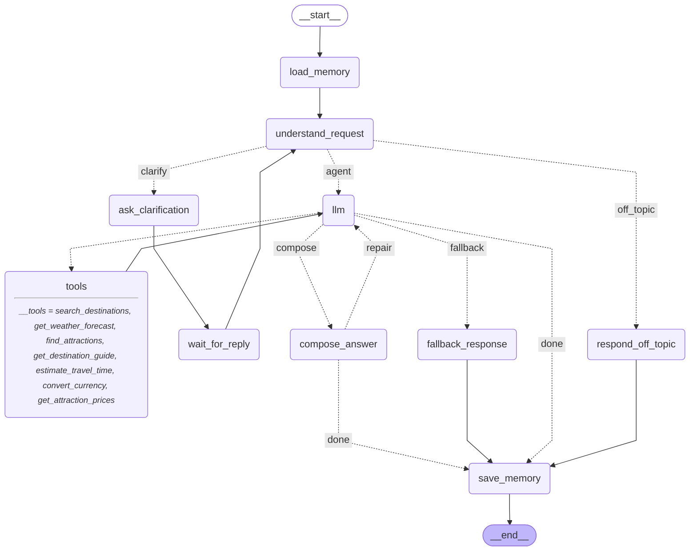

# AI Travel Assistant (Sri Lanka)

A single-agent travel assistant built with **LangGraph** and **Google Gemini**. Ask it to plan a trip ("Plan 3 days in Ella; I like hiking") and it gathers real data from free public APIs, writes a day-by-day itinerary, checks every place, price and travel time against the tool results, and tells you what it could not confirm.

It is a learning project, built stage by stage (see [docs/PROJECT_PLAN.md](docs/PROJECT_PLAN.md)). Each module's docstring explains the concept it demonstrates.

## What it does

- **Plans grounded itineraries.** Sights, distances, prices and forecasts must come from a tool result. Anything else is removed or flagged.
- **Asks when it must.** "Plan me a trip" gets a question about the place and the number of days, and the chat then carries on from your answer.
- **Edits plans.** Follow-ups such as "make day 2 easier" replace the plan.
- **Remembers.** Conversations are saved in SQLite and resume after a restart. Preferences ("I'm vegetarian") carry over to new conversations.
- **Fails honestly.** If an API is down, it says what is missing instead of making it up. The `FAULT_INJECT` switch simulates outages.
- **Is measured.** Thirty evaluation scenarios are scored against fixed targets.

### Data sources (free, no keys)

| Tool | Source |
|---|---|
| `get_weather_forecast` | Open-Meteo (geocoding and forecast) |
| `find_attractions` | OpenStreetMap via the Overpass API |
| `get_destination_guide` | Wikivoyage (MediaWiki API) |
| `estimate_travel_time` | OSRM road routing |
| `convert_currency` | ExchangeRate-API (open access) |
| `search_destinations` | A small built-in guide to Sri Lankan destinations |

Only Gemini needs a key.

## Architecture

The agent is one LangGraph state graph. This diagram is generated from the code (`uv run python -m ai_travel_assistant.studio --mermaid`), and a test fails if the two drift apart.



- **`load_memory` / `save_memory`**: long-term preferences, stored in a LangGraph Store.
- **`understand_request`**: one Gemini call that reads the message's intent and trip details. It routes the message to the agent, to a clarification question (`ask_clarification` → `wait_for_reply`, a human-in-the-loop interrupt), or to a polite off-topic reply.
- **`llm` ⇄ `tools`**: the ReAct loop. Gemini picks tools and reads their results, with a cap on rounds (`fallback_response` writes the best answer once the cap is reached).
- **`compose_answer`**: no LLM. It validates the submitted itinerary against a Pydantic schema, repairs it once or salvages what is valid, grounds it against the tool results, and renders it as Markdown.

The interfaces on top of the graph:

```
graph.stream(updates + messages) ──► streaming.py (Step / Token / TurnDone events)
                                          ├──► chat_ui.py   (rich terminal chat)
                                          └──► web_app.py   (Streamlit page)
```

## Setup

Requirements: Python 3.10+ and [uv](https://docs.astral.sh/uv/).

```powershell
git clone https://github.com/TharakaNisansala/AI-Travel-Assistant-Agent.git
cd AI-Travel-Assistant-Agent
uv sync
copy .env.example .env      # then set GEMINI_API_KEY and GEMINI_MODEL
```

Get a key from [Google AI Studio](https://aistudio.google.com/). Set `GEMINI_MODEL` to a current Flash model ID. The free tier is small (at the time of writing, about 5 requests a minute and 20 a day), and one itinerary takes about 4–5 requests.

**Using Groq instead.** Set `LLM_PROVIDER=groq` in `.env`, then set `GROQ_API_KEY` (from the [Groq console](https://console.groq.com/keys)) and `GROQ_MODEL` to a current Groq model ID that supports tool use. Every entry point (CLI chat, Streamlit page, Studio, evals) uses whichever provider is set. Switch back with `LLM_PROVIDER=gemini`. `smoke_gemini.py` below always checks Gemini only.

**Using Cloudflare Workers AI.** Set `LLM_PROVIDER=cloudflare`, then `CLOUDFLARE_API_TOKEN` (a token with Workers AI permission) and `CLOUDFLARE_ACCOUNT_ID`. `CLOUDFLARE_MODEL` is optional and defaults to `@cf/zai-org/glm-4.7-flash`; another model must support function calling. The agent reaches Workers AI through its OpenAI-compatible endpoint (`/ai/v1/chat/completions`) with `langchain-openai`, so tool calling, structured output and token streaming work as with the other providers.

Known limitations of `glm-4.7-flash` here (seen in live checks on 2026-11-18):

- **Itineraries are less reliable than with Gemini.** In one "Plan 2 days in Kandy" run it passed malformed place names to `estimate_travel_time` (`University_of_Peradeniya`), reached the 4-round tool cap, and its `submit_itinerary` failed validation, so the fallback reply was shown. That run coincided with an Overpass outage. A follow-up edit in the same chat produced a valid, checked itinerary.
- **Hidden reasoning tokens.** A one-sentence answer used about 540 output tokens and took about 10 s; one full plan used about 45,000 tokens and about 3 minutes. All of it counts toward the Workers AI daily free allowance (neurons).
- **Occasional slow calls.** One structured-output call hit the 120 s timeout. The agent retries a timeout once, then shows the "busy" message.
- **Daily allowance message.** When the daily allowance runs out, the chat may show the rate-limit message rather than the daily-quota one (the exact Cloudflare error has not been seen yet).
- `langchain-openai` may print a harmless Pydantic "serializer warnings" message during structured-output calls.

Check the setup with one request:

```powershell
uv run python smoke_gemini.py
```

## Using it

### Terminal chat (recommended)

```powershell
uv run python -m ai_travel_assistant.tool_calling --chat
```

You see each step as it happens ("🔎 Checking the weather in Ella"), replies as they are typed, and itineraries in a panel.

| In the chat | Does |
|---|---|
| `/itinerary` | prints the last itinerary as JSON |
| `/prefs`, `/forget` | shows or deletes your saved preferences |
| `/new` | starts a new conversation (the old one stays saved) |
| `/quit` | ends the chat and prints the id to resume it |

Options: `--thread <id>` resumes a conversation, `--user <name>` chooses whose preferences are used, `--no-clarify` skips the understanding step (one call fewer per message), and `--plain` gives plain text without live progress.

### One question

```powershell
uv run python -m ai_travel_assistant.tool_calling "Plan 2 days in Kandy" --steps
uv run python -m ai_travel_assistant.tool_calling "Plan 2 days in Kandy" --json
```

### Web page (optional)

```powershell
uv sync --extra ui
uv run --extra ui streamlit run src/ai_travel_assistant/web_app.py
```

The page is a chat with the same agent, conversations and progress steps as the terminal chat. The sidebar has a new-conversation button, the itinerary JSON and your saved preferences.

### LangGraph Studio (graph view and step-through)

`langgraph dev` needs Python 3.11+, so it runs in its own environment with this project installed:

```powershell
uvx --python 3.12 --from "langgraph-cli[inmem]" --with colorama --with-editable . langgraph dev
```

(`colorama` is needed on Windows.) It opens LangGraph Studio in the browser on the `travel_agent` graph (from [langgraph.json](langgraph.json)). There you can send messages, watch each node run, inspect the state, and answer the clarification interrupt. Studio keeps its own threads, and long-term memory is not part of the Studio graph.

### Simulating outages

```powershell
$env:FAULT_INJECT = "weather"              # or attractions, guide, travel, currency
$env:FAULT_INJECT = "weather,guide:busy"   # modes: down (default), busy, timeout
Remove-Item Env:FAULT_INJECT
```

## Testing and evaluation

```powershell
uv run pytest            # all offline tests: no key, no network
uv run pytest -m live    # a few live checks (spend Gemini quota)
```

The offline tests use a scripted fake model and fixed tool texts, so routing, memory, interrupts, error handling, structured output, streaming and the interfaces are tested without any API calls.

The evaluation suite (Stage 9) runs 30 scenarios from [evals/scenarios.yaml](evals/scenarios.yaml) and scores them against the targets in the plan:

```powershell
uv run python -m ai_travel_assistant.evals.run --dry-run     # what would run, estimated calls
uv run python -m ai_travel_assistant.evals.run               # 18 calls a day by default
uv run python -m ai_travel_assistant.evals.run --run-id <id> # continue the run the next day
uv run python -m ai_travel_assistant.evals.scorecard         # score the saved run
uv run pytest -m eval                                        # sign-off against the targets
```

A run saves one JSON record per scenario in `evals/runs/<run-id>/`. Scoring reads only those records, so you can re-score at no cost. `--judge` adds an LLM judge (one call per plan).

### Tracing (optional)

LangSmith tracing is off. To send traces to your own LangSmith project, set `LANGSMITH_TRACING=true` and `LANGSMITH_API_KEY` in `.env`. The conversations are then stored on LangSmith's servers.

## Project layout

```
src/ai_travel_assistant/
  tool_calling.py          the agent graph, the CLI and the plain chat
  streaming.py, chat_ui.py, web_app.py, studio.py   interfaces (Stage 10)
  tools.py, *_service.py   tools and their API clients
  request_understanding.py understanding and clarification (Stage 6)
  robustness.py, resilience.py, faults.py           errors and outages (Stage 7)
  schemas.py, itinerary_grounding.py, itinerary_output.py  itineraries (Stage 8)
  long_term_memory.py, context_window.py            memory (Stage 5)
  evals/                   the evaluation suite (Stage 9)
evals/scenarios.yaml       evaluation scenarios
tests/                     offline tests (plus live and eval markers)
docs/PROJECT_PLAN.md       the stage-by-stage plan and what was built
```

## Limitations

- No bookings, payments or availability checks. Prices are the ones quoted in the guide, not live prices.
- OpenStreetMap data can be thin for smaller places, and the free APIs have rate limits. The agent says when data is missing.
- Sri Lanka first, and English only.
- The Gemini free tier allows about 20 requests a day, which is enough for a few itineraries.
