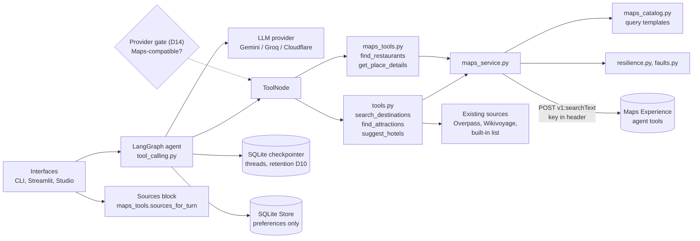
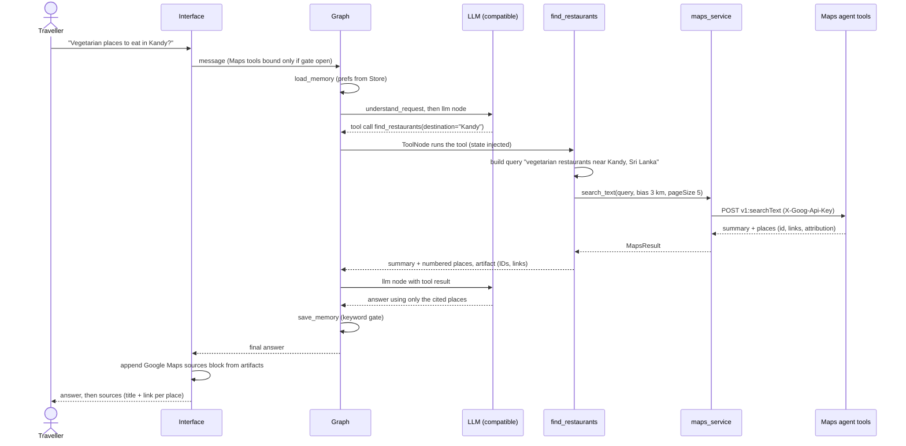
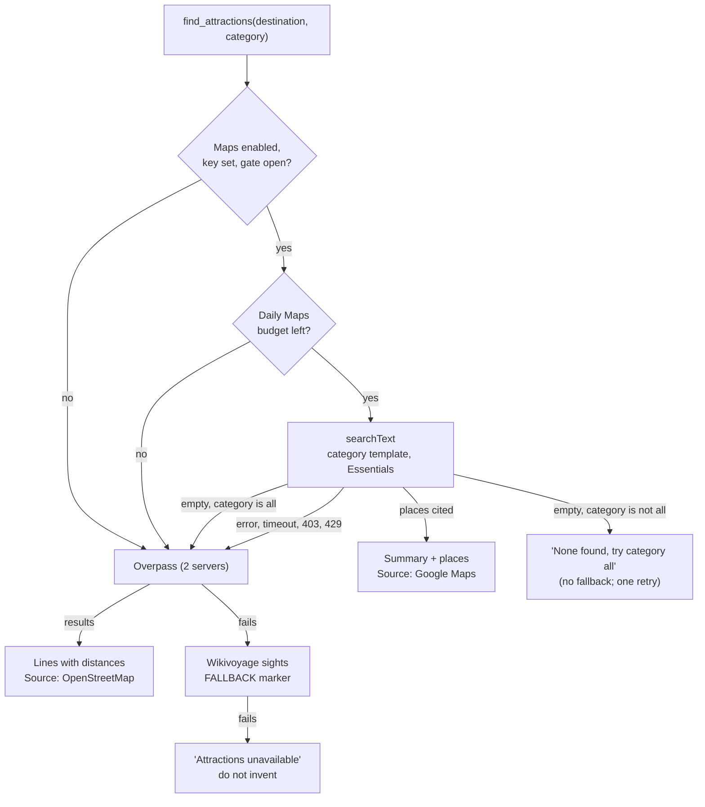
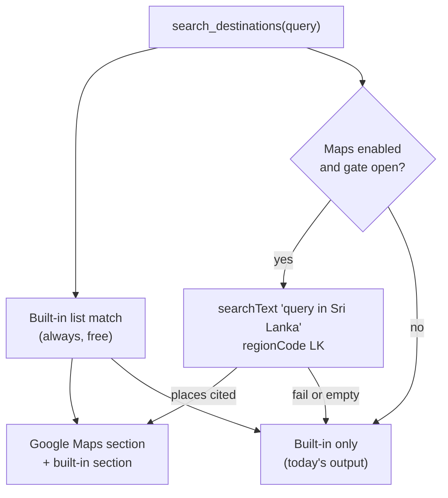

# Google Maps integration plan (Maps Experience agent tools)

- **Project:** the personal AI Travel Assistant learning project (this repository). It is not RAAHI's Izzy assistant or any RAAHI production system, and no RAAHI or Izzy requirements, architecture or business rules apply to this plan.
- **Status:** Planning only: nothing in this document exists in the code. Revision 2: D1–D8, D11, D12 and D13 confirmed; D9 pending the owner; D10 and D14 pending Stage 1 ([§12a](#12a-decisions)). Stage 1: tasks 1–3 done, tasks 4–8 prepared and waiting for the owner.
- **Date:** 2026-11-25 (revision 2).
- **Scope:** dynamic discovery of destinations, attractions, hotels and restaurants, using Google Maps data through **Maps Experience agent tools** (formerly Maps Grounding Lite). Sri Lanka first.
- **File name:** kept as `google-places-api-integration-plan.md` so existing links keep working; the provider is no longer Places API (New).
- **Related:** [architecture.md](../architecture.md), [ADR-0001](../decisions/0001-sqlite-persistence.md) (SQLite memory), [ADR-0003](../decisions/0003-services-and-tools.md) (services and tools), [ADR-0004](../decisions/0004-llm-provider-switch.md) (LLM providers), [ADR-0005](../decisions/0005-public-provider-fallback.md) (provider fallback), [DEPLOYMENT.md](../DEPLOYMENT.md) (public demo).

## Revision history

| Revision | Date | Change |
|---|---|---|
| 1 | 2026-11-25 | First plan: Google **Places API (New)** as the primary provider. D1–D6, D8 and D12 confirmed. |
| 2c | 2026-11-25 | Stage 1 tasks 4–8 prepared: demo-key steps and an offline-checked test kit (Appendix A), observation table (Appendix B), evidence and recommendations for P3, P4, P6, P8 and new P10 ([§5.15](#515-stage-1-task-7-p3-p4-p6-p8-and-p10)), D9 options with recommendation D ([§7.8](#78-restaurants-in-itineraries-options-for-d9-stage-1-task-8)). ToS 3.2.3(d), (e), (g) added to §5.1. No requests to Google made. |
| 2b | 2026-11-25 | Stage 1 tasks 2 and V1 done ([§5.14](#514-stage-1-results-tasks-2-and-v1)): P1a, P2, P7 answered; P1 split into P1a/P1b; P9 added; D14 evidence recorded (still pending the owner's account confirmations and P1b). |
| 2a | 2026-11-25 | Owner confirmed D4, D5, D7 (A), D11 (A) and D13 (A). D14 widened to the whole fallback chain and thread history. Demo key restricted to local Stage 1 testing. |
| 2 | 2026-11-25 | **Provider changed to Maps Experience agent tools** (owner's choice, Option A). Reason: Stage 1's reading of Google's terms found that Places API (New) content may not be used to generate LLM answers, while Maps Experience agent tools has an explicit exception for exactly that ([§5.1](#51-why-the-provider-changed)). D4, D5 and D7 revisited; D10 and D13 updated to the applicable policies; D14 (LLM provider compatibility) added; D9 kept pending. Diagrams, API mapping, costs, tests and Stage 1 rewritten. |

## How to read this document

Every statement about Google is labelled:

| Label | Meaning |
|---|---|
| **Verified** | Read on the official Google page listed in [§20](#20-references), on 2026-11-25, with the quoted wording |
| **To verify** | Not stated on the pages read, or open to more than one reading. Must be settled in Stage 1 (see the questions in [§5.12](#512-open-policy-questions)) before code depends on it |
| **Assumption** | A reasonable expectation that has not been checked |
| **Proposed** | A design recommendation. Final only when confirmed in [§12a](#12a-decisions) |

This document records a careful reading of Google's terms for a personal learning project. It is not legal advice.

---

## Contents

1. [Executive summary](#1-executive-summary)
2. [Current architecture assessment](#2-current-architecture-assessment)
3. [Current limitations](#3-current-limitations)
4. [Integration objectives](#4-integration-objectives)
5. [Google research: terms and Maps Experience agent tools](#5-google-research-terms-and-maps-experience-agent-tools)
6. [Proposed architecture](#6-proposed-architecture)
7. [Agent tool design](#7-agent-tool-design)
8. [Data flow diagrams](#8-data-flow-diagrams)
9. [Proposed project structure](#9-proposed-project-structure)
10. [Existing destination list migration](#10-existing-destination-list-migration)
11. [Memory and storage](#11-memory-and-storage)
12. [Security and API key management](#12-security-and-api-key-management), then [12a. Decisions](#12a-decisions)
13. [Pricing and cost considerations](#13-pricing-and-cost-considerations)
14. [Error handling and reliability](#14-error-handling-and-reliability)
15. [Testing strategy](#15-testing-strategy)
16. [Incremental implementation roadmap](#16-incremental-implementation-roadmap)
17. [Risks and mitigation strategies](#17-risks-and-mitigation-strategies)
18. [Acceptance criteria](#18-acceptance-criteria)
19. [Future enhancements](#19-future-enhancements)
20. [References](#20-references)

Appendices: [A. Stage 1 test kit](#appendix-a-stage-1-test-kit-tasks-4-and-5) · [B. Stage 1 observations](#appendix-b-stage-1-observations-task-6)

---

## 1. Executive summary

Today the agent chooses destinations from a hand-written list of 10 Sri Lankan places (`DESTINATIONS` in `tools.py`). Attractions come from OpenStreetMap (Overpass), hotels from Wikivoyage "Sleep" listings, and restaurants are not covered. All sources are free and need no keys.

This plan adds Google Maps data as the primary discovery source, behind a feature flag, without replacing anything that works:

- **Provider: Maps Experience agent tools**, called through its REST method `searchText` with `httpx`. Google's terms allow its results to be used to ground an LLM's answer ("Grounded Output"); they do not allow that for Places API (New) ([§5.1](#51-why-the-provider-changed)). It works with any LLM, so the Gemini, Groq and Cloudflare setup stays.
- **What a search returns:** an **AI-generated summary written by Google** that cites places as `[0]`, `[1]`…, plus for each cited place its ID, coordinates, Google Maps links and an attribution (title and link). Names, ratings, addresses, price signs and opening hours appear only inside the summary text; there are no structured fields for them.
- **One new service module** (`maps_service.py`) in the existing `*_service.py` pattern: `httpx`, `send_with_retry`, typed errors, fault injection, no LangChain imports. **No new dependency.**
- **Tools:** `search_destinations`, `find_attractions` and `suggest_hotels` are extended (same names); `find_restaurants` and `get_place_details` are new. Every search query is built **in code** from fixed templates, so costs and wording stay under control.
- **Google Maps sources are added by code**, not by the LLM: after every answer that used Maps results, the interface prints a "Google Maps" sources block (title and link per place), as the attribution rules require.
- **Only "Maps-compatible" LLM providers may see Maps results:** Google requires that the LLM does not store or train on the data. Each provider (especially the **Gemini free tier**) is checked in Stage 1, and code disables the Maps tools for any provider not on the verified list (new decision D14).
- **Storage:** chat history with Grounded Output may be kept for up to 2 years; evaluation copies for up to 30 days (Verified, SST §10.2.2). Nothing from Maps goes into the Store, committed files, or test fixtures.
- **Cost:** Essentials only (code never sends Pro options): 10,000 free requests a month, then $7 per 1,000 (Verified). Expected personal use is about 600 a month, so $0. Stage 1 can use the free **Maps Demo Key** with no billing account.

**Recommended first step:** Stage 1 (terms checks, LLM provider verification, demo-key test calls). It writes no application code.

---

## 2. Current architecture assessment

Based on the code as of commit `a29e957` (branch `feat/public-deployment`). Unchanged from revision 1.

### 2.1 The agent

- One LangGraph `StateGraph` built by `build_tool_agent_graph()` in `tool_calling.py`; interfaces call `build_chat_graph()`.
- Turn flow: `load_memory` → `understand_request` (structured output, temperature 0) → pure-Python routing → `llm` ⇄ `tools` (ReAct loop, `MAX_TOOL_ROUNDS = 4`) → `compose_answer` (no LLM, for `submit_itinerary`) or `fallback_response` → `save_memory`.
- Tools are registered in the `TOOLS` tuple in `tool_calling.py`. `bind_tools()` sends their schemas to the model; `ToolNode(handle_tool_errors=...)` runs them in parallel.
- Tool choice is driven by tool names, docstrings and `SYSTEM_PROMPT`. `system_prompt_for()` adds saved preferences and the current trip on every LLM call.
- Three LLM providers (`LLM_PROVIDER`: Gemini, Groq, Cloudflare; [ADR-0004](../decisions/0004-llm-provider-switch.md)) and a fallback pool for the public demo ([ADR-0005](../decisions/0005-public-provider-fallback.md)). Groq validates tool arguments strictly against the schema.

### 2.2 Tools and services that this integration touches

| Tool (`tools.py`) | Today's source | Logic in the tool |
|---|---|---|
| `search_destinations(query)` | Built-in `DESTINATIONS` (10 places), keyword scoring in `find_destinations()` | Output ends "Source: the assistant's built-in offline guide (not live data)." |
| `find_attractions(destination, category, country_code)` | `attractions_service.py` (Overpass, two servers), geocoding via Open-Meteo | `category` is a `Literal`: `nature`, `culture`, `landmarks`, `all`; OSM tags in `CATEGORY_FILTERS`. Falls back to Wikivoyage sights (`attractions_from_guide`) |
| `suggest_hotels(destination, state)` | `hotel_service.py` (Wikivoyage "Sleep" wikitext) | Reads `trip_request` from `InjectedState`; budget filter; returns an **artifact** read by `itinerary_budget.py` |
| `get_destination_guide` | `guide_service.py` (Wikivoyage) | Topic trimming |
| `get_weather_forecast` | `weather_service.py` (Open-Meteo); its `geocode()` is reused | — |

Shared infrastructure the new service reuses: `resilience.send_with_retry` (2 attempts; retries 429, 502–504, timeouts), `resilience.TTLCache`, `faults.py` (`FAULT_INJECT=<service>:<mode>`), typed exceptions per service turned into "… unavailable" text by the tool.

### 2.3 Grounding

`itinerary_grounding.py` checks every submitted itinerary against the thread's tool results, by tool name and text format:

- `collect_evidence()` pairs each `ToolMessage` with its call; results starting with `UNAVAILABLE_PREFIXES` count as failures.
- `sources_for()` reads `search_destinations` text as built-in evidence and parses `find_attractions` lines with `_OSM_LINE` (`- Name (kind), 1.2 km`).
- `schemas.ActivitySource` is `Literal["OpenStreetMap", "Wikivoyage", "Built-in guide"]`; Wikivoyage sights already have **no distance**, which the schema allows.
- `itinerary_output.py`, `web_ui.py`, `itinerary_pdf.py` show each activity's source and a "Sources:" line.

### 2.4 Configuration, memory, testing

- Secrets from `.env` / Streamlit Secrets; `LLMSettings.api_key` uses `field(repr=False)`. `usage_limits.py` caps LLM calls in public mode.
- `SqliteSaver` (`.data/chat.sqlite`) keeps every thread, **including every `ToolMessage`**, with no pruning; `SqliteStore` keeps preference strings ([ADR-0001](../decisions/0001-sqlite-persistence.md)).
- Tests are offline by default (`no_real_network` in `conftest.py`), use `httpx.MockTransport` and fixtures; `@pytest.mark.live` and `@pytest.mark.eval` are opt-in. `tests/test_tool_selection.py` has 19 first-step cases. Eval records in `evals/runs/` and reports in `docs/itinerary_checks/` contain raw tool output **and are committed to this public repository**.

---

## 3. Current limitations

| Limitation | Where | Effect |
|---|---|---|
| Fixed destination list of 10 places | `tools.DESTINATIONS` | Anything else gets "No destinations in the offline guide matched" |
| OpenStreetMap coverage is thin; Overpass is often down | `attractions_service.py` | Both committed itinerary checks record `find_attractions` as failed |
| Only four attraction categories | `attractions_service.Category` | Waterfalls, beaches, temples, parks are mapped loosely |
| Hotels only from Wikivoyage | `hotel_service.py` | Small towns often have no listings; listings can be years old |
| No restaurant search | `SYSTEM_PROMPT` | The agent must say it cannot help |
| No per-place details | — | Opening-hours questions cannot be answered from a source |

---

## 4. Integration objectives

| ID | Capability | Example request | Served by (proposed) |
|---|---|---|---|
| A | Destination discovery by country, region, city and interest | "Best nature destinations in Sri Lanka" | `search_destinations` (extended) |
| B | Attraction discovery: waterfalls, beaches, temples, parks, museums, landmarks | "Waterfalls near Ella", "temples in Kandy" | `find_attractions` (extended) |
| C | Hotel discovery, with budget wording where possible | "Mid-range hotels in Galle" | `suggest_hotels` (extended) |
| D | Restaurant discovery by cuisine, diet and location | "Vegetarian restaurants in Kandy" | `find_restaurants` (new) |
| — | Facts about one named place | "Is the Temple of the Tooth open in the evening?" | `get_place_details` (new) |

Non-goals: bookings, room availability, live room prices, table reservations, payments.

---

## 5. Google research: terms and Maps Experience agent tools

### 5.1 Why the provider changed

Read directly from the current official texts on 2026-11-25: the Google Maps Platform **Terms of Service** (last modified 2026-08-26) and **Service Specific Terms** ("SST", last modified 2026-11-24).

| Clause | Verified wording | Consequence |
|---|---|---|
| ToS 3.2.3(c) | "No Creating Content From Google Maps Content. Customer will not create content based on Google Maps Content." One example: "(vi) convert text-based driving times into synthesized speech results" | Turning Maps data into new text is "creating content" |
| ToS 3.2.3(b) | "Customer will not cache Google Maps Content except as expressly permitted under the Maps Service Specific Terms." | Storage needs an explicit permission |
| ToS 3.2.3(a) | Do not "pre-fetch, index, store, reshare, or rehost Google Maps Content outside the services" or "copy and save business names, addresses, or user reviews" | No copies in files or databases beyond what is permitted |
| SST §15 (Places API, Legacy and New) | Use without a Google map is allowed; use "in conjunction with a non-Google map" is not; latitude/longitude may be cached "for up to 30 consecutive calendar days" | **No exception for LLM use** |
| SST §10 (Maps Experience Agent Tools) | "As a limited exception … to the prohibition on using Google Maps Content to create content, Customer may use Maps Experience Agent Tools to ground a LLM to generate and display Grounded Output to End Users if (i) Customer complies with the Generative AI Prohibited Use Policy … and (ii) Customer includes associated Google Maps source links with the Grounded Output" | **The explicit permission this project needs** |
| Services list | "Maps Experience Agent Tools" and "Places API (New)" are listed as separate services | The §10 exception does not extend to Places API (New) |
| Core Services | ToS: "'Services' and 'Google Maps Core Services' means the services described at" the services list, which is titled "Generally Available Google Maps Platform Core Services" and includes "Maps Experience Agent Tools" | Every ToS 3.2.3 restriction applies to this project's use (added in Stage 1 task 7) |
| ToS 3.2.3(d)(iii) | "Customer will not … use the Google Maps Core Services in a listings or directory service" | Results appear only as answers to a traveller's question; no browsable list or directory of Maps places (P10) |
| ToS 3.2.3(e) | "Customer will not use the Google Maps Core Services with or near a non-Google Map" | The app shows no maps; no OpenStreetMap or other map is shown with Maps content |
| ToS 3.2.3(g) | "Customer will not modify any of the Google Maps Core Services' search results." | Code passes Google's results to the model unchanged: no re-ranking, dropping or editing of returned places (P3) |

### 5.2 What Maps Experience agent tools is (Verified)

- "A Google Maps Platform service with Model Context Protocol (MCP) and REST support to ground your AI applications with trusted geospatial data from Google Maps." Formerly Maps Grounding Lite.
- Works with "any model or agent framework that supports MCP or can call REST APIs". (The Gemini-only sibling is "Grounding with Google Maps", see D13.)
- Tools: `search_places` (REST `searchText`), `search_along_route`, `lookup_weather`, `compute_routes`, `resolve_names`, `resolve_maps_urls`. This plan uses **`searchText` only**.
- Google's REST guidance: "Call the REST methods directly when you want to wire the tools into your own agent or application — for example, to declare your own functions for a model, choose which options the model can set, or set default values in your code."
- Google's own caveat: the LLM's "final response might not include the exact information that the MCP server returned. Verify the accuracy of the generated response."

### 5.3 `searchText` request (Verified)

`POST https://mapstools.googleapis.com/v1:searchText`, headers `Content-Type: application/json` and `X-Goog-Api-Key`.

| Field | Notes |
|---|---|
| `textQuery` | Required. "The query must contain enough location information to be unambiguous, or the request must include `location_bias`." |
| `locationBias` | Circle: `center` and optional `radius_meters`, up to 50,000 m. "If `text_query` names an explicit location, that location is used instead." |
| `languageCode` | Language of the summary; default English |
| `regionCode` | CLDR code of the user's region, e.g. `LK`; "can affect results based on applicable law" |
| `pageSize` | Default 5, maximum 10; **6–10 is a Pro option**; above 10 returns `INVALID_ARGUMENT` |
| `includeExtendedDetails` | Default false; **true is a Pro option** (insights from reviews, menus, atmosphere, visitor tips, proximity). Leave false for "cuisines or store types, addresses, contact information, opening hours, and standard amenities" |

There are **no type filters, field masks, price filters or rating filters**.

### 5.4 `searchText` response (Verified)

- `summary`: "A natural language summary of the search results. It might contain zero-based citations, such as `[0]`, that map to entries in `places`." Google's example of an Essentials summary line: "**Example Trattoria** [0] (4.6★ (1,250) · 123 W Example St · $$$) A neighborhood trattoria known for handmade pasta and a long wine list."
- `places[]`, for each cited place: `place` (`places/{id}`), `id`, `location` (lat/lng), `googleMapsLinks` (`placeUrl`, `directionsUrl`, `reviewsUrl`, `photosUrl`, `writeAReviewUrl`), `attribution` (`title`, `url`).
- `contentToken`: for Places UI Kit display (Preview); not used.
- The structure is the same for Essentials and Pro.
- **To verify (Stage 1):** that `attribution.title` is the place's display name in practice; how often summaries include rating, price sign and opening hours for Sri Lankan places; whether the summary language and citation format are stable.

### 5.5 Essentials and Pro (Verified)

- One product, two SKUs, same endpoint and key. "A request is billed under Pro when it uses a Pro option. Every other request is billed under Essentials." A request is never billed under both.
- For `searchText`, the Pro options are `pageSize` 6–10 and `includeExtendedDetails: true`.
- "If you call the tools with REST, your code sets every option." This plan's tool schemas do not expose either option, so the model cannot trigger Pro.

### 5.6 Pricing and quotas (Verified)

| SKU | Free per month | Then |
|---|---|---|
| Maps Grounding Essentials | 10,000 requests | $7.00 per 1,000, with volume discounts |
| Maps Grounding Pro | 5,000 requests | $14.00 per 1,000, with volume discounts |
| Resolution API (`resolveNames`, `resolveMapsUrls`) | Unlimited (billed under Places Text Search Essentials IDs Only at no charge) | $0 |

- Quota: "Search places: 300 queries per minute for each project", shared by both SKUs.
- A billing account is required ("Enable billing for the project"), **except** with the Maps Demo Key ([§5.10](#510-maps-demo-key)).
- From the general billing pages (revision 1, Verified): budget alerts only notify and do not cap spending; daily quotas can be lowered in the console.

### 5.7 Attribution (Verified)

- "The Google Maps sources must immediately follow the generated content that the sources support" and "must be viewable within one user interaction."
- For each place: a link preview that attributes the source to Google Maps, displays the **source title** as provided, and links with `googleMapsLinks.placeUrl` (main page) / the attribution `url` (attribution page). **To verify** which URL to prefer when they differ.
- Text "Google Maps": do not modify, wrap or localize it; use `translate="no"` in HTML; font Roboto or the product's sans-serif, weight 400, 12–16sp, colour `#1F1F1F`, `#5E5E5E` or white with 4.5:1 contrast.
- Voice interfaces have extra rules; this project has none.
- SST §10.2.1 also requires compliance with the **Generative AI Prohibited Use Policy** (to read in Stage 1).

### 5.8 Storage and caching (Verified, SST §10.2.2 and §3)

- "Customer may cache Grounded Output: (1) for up to thirty (30) consecutive days for the purpose of evaluating and optimizing the performance or display of the Grounded Output for the Customer Application or (2) in the chat history of an End User of the Customer Application for up to two (2) years for the purpose of allowing that End." (The published sentence ends there; the intended purpose is presumably to let the end user see their history. **To verify**.)
- "Grounded Output means output created when Google Maps Content is combined with the output of any LLM."
- SST §3: "Customer may cache the Google ID values … For example, Customer may cache (a) place_id from Places API …". Whether this covers IDs from Maps Experience agent tools is **To verify**; the plan stores IDs only inside chat history and artifacts, never separately.
- SST §10.3: do not "attempt to extract or otherwise separate Google Maps Content from the Grounded Output"; do not "use Grounded Output to train, develop, or improve any machine learning models or artificial intelligence systems"; do not "modify or intersperse content with the Grounded Output, insert interstitial content".

### 5.9 Requirements for the LLM (Verified)

"You may only use Maps Experience agent tools with an LLM that is compliant with the Google Maps Platform Terms of Service. For example, you are responsible for ensuring that Google Maps Content is not cached by, stored by, or used to improve the LLM that you choose to use. … You must not use Maps Experience agent tools with any models that use the data input into the model for any model training or improvement."

This applies to **every** provider that may receive a Maps result: the main provider and every fallback provider in the pool. Stage 1 task V1 checks each one ([§16](#16-incremental-implementation-roadmap)); D14 enforces the result in code.

### 5.10 Maps Demo Key

- Verified: a no-cost key "without entering billing information", for "testing and prototyping purposes only, and is not designed for production use", subject to the **Maps Demo Project Terms of Service**. Supports Maps Experience agent tools. Requires a personal Google Account (not Workspace). "If you reach the daily limit, your usage is paused until the following day with no risk of charges." The daily limits are not stated.
- The Maps Demo Project Terms were read in Stage 1 task 2 ([§5.14.1](#5141-maps-demo-project-terms-task-2)): evaluation and testing only, production use "strictly prohibited", limits can change "at any time without notice".
- **Still to verify (task 5):** whether the demo key can be restricted to one API; its actual daily limit.
- Consequence: Stage 1 and local development can use it with **no billing account**. The public demo must not use it (D11).

### 5.11 Errors

- Verified: `pageSize` above 10 returns `INVALID_ARGUMENT`.
- **Assumption** (standard Google APIs, recorded in Stage 1): 400 `INVALID_ARGUMENT`, 403 `PERMISSION_DENIED` (bad key, API not enabled on the key, billing), 429 `RESOURCE_EXHAUSTED` (quota or demo daily limit), 5xx server errors, JSON body `{"error": {"code", "message", "status"}}`.

### 5.12 Open policy questions

Each must be answered (from the documents, or by asking Google support) or explicitly accepted as a risk in Stage 1. The plan takes the **conservative** design for each until then.

| ID | Question | Status (2026-11-25) | Conservative design until answered |
|---|---|---|---|
| P1a | Which providers use inputs for training or improvement (the hard rule in §5.9)? | **Answered** by V1 ([§5.14.3](#5143-v1-llm-provider-data-use-comparison)): Gemini free tier does; Gemini paid, Groq and Cloudflare Workers AI do not | Gemini free tier never receives Maps data |
| P1b | Does a provider's temporary abuse or reliability logging count as Maps content being "cached by, stored by" the LLM (§5.9)? | **Open** (interpretation; only Google can settle it) | Treat it as storage: only providers with zero retention for the requests we send are eligible |
| P2 | What do the Maps Demo Project Terms allow? | **Answered** ([§5.14.1](#5141-maps-demo-project-terms-task-2)) | Demo key only for local evaluation and testing; never deployed |
| P3 | Is `itinerary_grounding` / `compose_answer` removing unconfirmed facts from an itinerary "modifying" Grounded Output (SST §10.3.3)? Is checking place names against `attribution.title` "separating" Maps content (§10.3.1)? | **Recommendation ready**, owner to decide ([§5.15](#515-stage-1-task-7-p3-p4-p6-p8-and-p10)) | Google's results reach the model unchanged (ToS 3.2.3(g)); grounding **flags** Maps names but never rewrites Maps-derived text; it removes only statements no source supports, counting the Maps summary as a source; the sources block directly follows the answer |
| P4 | Is computing distances or country checks from returned coordinates "creating content" (ToS 3.2.3(c), example (iv) "use latitude/longitude values from the Places API as an input for point-in-polygon analysis")? | **Recommendation ready**, owner to decide ([§5.15](#515-stage-1-task-7-p3-p4-p6-p8-and-p10)) | **No calculations on Google coordinates**: no distances, no bounding-box checks. Maps sights carry no distance, like Wikivoyage sights |
| P5 | Do tool messages (the raw `summary` before the LLM uses it) in `chat.sqlite` fall under the 2-year chat-history allowance? | Open | Treat the whole thread as chat history and apply the D10 retention to it |
| P6 | Is a downloaded PDF of an itinerary allowed, and how must sources appear in it? | **Recommendation ready**, owner to decide ([§5.15](#515-stage-1-task-7-p3-p4-p6-p8-and-p10)) | PDF export is off for itineraries that contain Maps content (the button explains why); unchanged for itineraries without Maps content |
| P7 | Does the Generative AI Prohibited Use Policy restrict anything this assistant does? | **Answered** ([§5.14.2](#5142-generative-ai-prohibited-use-policy-task-2)): no restriction on travel planning | Keep answers honest about being AI-generated; keep the existing "check the official site" rule for visa advice |
| P8 | Is a plain-text "Google Maps: title — URL" block acceptable in the terminal (no link preview possible)? | **Recommendation ready**, owner to decide ([§5.15](#515-stage-1-task-7-p3-p4-p6-p8-and-p10)) | Print a "Sources: Google Maps" block directly after the answer: each title with its full URL (clickable in the rich chat) |
| P10 | **New (task 7):** does answering hotel and restaurant questions with Maps results make the app a "listings or directory service" (ToS 3.2.3(d)(iii))? | **Recommendation ready**, owner to decide ([§5.15](#515-stage-1-task-7-p3-p4-p6-p8-and-p10)) | Maps results only as answers to a traveller's own question, inside a planning assistant; no browsable lists, saved collections or directory pages of Maps places |
| P9 | **New:** SST §10.3.2 forbids using Grounded Output "to train, develop, or improve any machine learning models or artificial intelligence systems", while §10.2.2(1) allows caching it "for the purpose of evaluating and optimizing the performance or display of the Grounded Output". Is tuning this agent's prompts from Maps-based eval results "improving an AI system"? | Open (interpretation) | Eval scores and pass/fail counts may be used; Maps-derived text is never copied into prompts, few-shot examples, docs or datasets; eval copies follow the 30-day rule (D10) |

### 5.13 Alternatives considered

| Alternative | Status | Why |
|---|---|---|
| Places API (New) + LLM | Rejected in revision 2 | No LLM exception in the terms ([§5.1](#51-why-the-provider-changed)) |
| Grounding with Google Maps (Gemini built-in) | Not used (D13) | Gemini-only; the agent tools are Google's provider-neutral equivalent |
| Agent tools through MCP (`langchain-mcp-adapters`) | Not now (D4 option B) | New dependency; the model would set Pro options; good future learning topic |
| Agent tools `lookup_weather` / `compute_routes` instead of Open-Meteo / OSRM | Not now | Today's free sources work; would widen the policy surface |

### 5.14 Stage 1 results: tasks 2 and V1

All sources read on **2026-11-25** from the official pages listed. Quotes are verbatim. "Interpretation" marks this plan's reading; "Owner to confirm" marks account settings that cannot be seen from the documents.

#### 5.14.1 Maps Demo Project Terms (task 2)

Source: Maps Demo Project Terms of Service (last modified 2026-09-13).

| Clause | Verbatim wording | Implication for this project |
|---|---|---|
| Scope | "By clicking to accept this Agreement, Customer also agrees to all terms of the following: the Google Maps Platform Terms of Service … the Google Cloud Platform Terms of Service or Starter Tier Additional Terms of Service … and this Agreement." | Every Maps rule in §5.1–§5.9 (no creating content except the agent-tools exception, storage limits, attribution, LLM requirements) applies to demo-key use too |
| Purpose | "an API and usage-limited project (the "Maps Demo Project") to allow users to evaluate GMP products without attaching a billing account" | Fits Stage 1 and local development |
| No production use | "intended solely for evaluation and testing. It is not intended for production use. Production use is strictly prohibited." | Confirms the owner's rule and D11: never on the public demo |
| Eligibility | "Each Google account may have only one (1) Maps Demo Project with an authentication method at any given time." | One demo key per Google account |
| Usage limits | "Google may enforce, adjust, or zero-out these usage limits at any time without notice. Once the limit is reached, the Service will cease to function until the limits resets" | The app must treat a demo-key 429 / refusal as a normal fallback case (§14); no reliance on fixed numbers |
| Termination | "Google reserves the right to suspend or terminate Customer's access to the Maps Demo Project at any time, for any reason, without notice or liability." | Development must keep working without Maps (already true: D2 fallbacks) |
| Liability | "Customer is solely responsible for any activity that occurs under Customer's Maps Demo Project, including the activities of any third parties or end users Customer authorizes or allows to access" | Another reason to keep the key local and private |
| Data use | "Google may use usage data from the Maps Demo Project to improve our products." | Concerns Google's own usage data; no action for this project |

#### 5.14.2 Generative AI Prohibited Use Policy (task 2)

Source: Generative AI Prohibited Use Policy (last modified 2024-12-17). Required by SST §10.2.1.

- The policy forbids, among others, dangerous or illegal activity, privacy violations ("Tracks or monitors people without their consent"), security abuse, sexually explicit, violent or hateful content, and misinformation.
- Clauses closest to this project: "Facilitating misleading claims of expertise or capability in sensitive areas -- for example in health, finance, government services, or the law, in order to deceive" and "Misrepresenting the provenance of generated content by claiming it was created solely by a human, in order to deceive."
- **Interpretation:** a travel assistant that answers from cited sources is within the policy. The existing rules already fit: visa questions point to the official immigration site, and answers are not presented as human-written. **P7 answered:** no design change.

#### 5.14.3 V1: LLM provider data use (comparison)

| | Gemini API, free tier (unpaid quota) | Gemini API, paid tier (Developer API) | Groq (GroqCloud) | Cloudflare Workers AI |
|---|---|---|---|---|
| **Inputs used for training or improvement?** | **Yes.** "Google uses the content you submit to the Services and any generated responses to provide, improve, and develop Google products and services and machine learning technologies" | **No.** "Google doesn't use your prompts … or responses to improve our products" | **No.** "Groq is not permitted to use Inputs or Outputs for training or fine-tuning any AI Model Services or other models, unless explicitly granted permission or instructed by Customer." | **No.** "Cloudflare does not use Customer Content processed by Workers AI to train AI models." |
| **Human review** | "human reviewers may read, annotate, and process your API input and output" | Only flagged content, for policy enforcement | Only for reliability or abuse investigation (logs), and for feedback you submit | Not stated |
| **Storage by default** | Not separately stated for unpaid use (data used for product development) | Abuse-monitoring logs: "Google retains the following data for fifty-five (55) days" (prompts, context, output). Developer logs: "Logging is on by default … for Generate Content API calls in projects created on or after October 26, 2026", kept "for a default maximum period of 55 days" | "By default, Groq does not retain customer data for inference requests." It "may temporarily log inputs and outputs" for reliability or abuse, "retained for up to 30 days, unless legally required to retain longer" | "For standard inference requests that do not invoke a stateful feature, Cloudflare does not retain inputs or outputs after they are no longer needed to process the request" |
| **Zero-retention option** | None | Developer logs can be turned off or shortened (7–55 days). Abuse logging has no off switch on the Developer API: "If your workload requires guaranteed zero data retention or enterprise data processing agreements, use Vertex AI." | "All customers may enable Zero Data Retention (ZDR) in Data Controls settings." Then Groq "will not retain customer data for system reliability and abuse monitoring". The Services Agreement says "Eligible Customers may enable" it | Default behaviour. The model this project uses, `@cf/zai-org/glm-4.7-flash`, is listed as "Cloudflare-hosted" with "Zero data retention: Yes" |
| **Limits and exceptions** | Applies outside the EEA, Switzerland and the UK (Sri Lanka included) | Logs are separate from abuse logs. Sharing logs as datasets moves them to the unpaid terms | ZDR disables batch and fine-tuning (not used here). **Feedback** you submit is stored "for up to 3 years" and used to improve product quality | Storage happens if you use AI Gateway logging or caching, application logs, storage services or batch. This project calls the Workers AI endpoint directly (`llm_basics.py`, `CLOUDFLARE_BASE_URL`), not AI Gateway. Legal-obligation retention is "not used to train AI models" |
| **Source** | Gemini API Additional Terms (effective 2026-03-23), "Unpaid Services" | Gemini API Additional Terms, "Paid Services"; Abuse monitoring; Zero data retention; Data logging and sharing pages | "Your Data in GroqCloud"; Groq Services Agreement §4.2; Groq feedback policy | Workers AI "Data usage" (modified 2026-10-16); model page for `glm-4.7-flash` |
| **Owner to confirm** | Whether the project's Gemini key is on unpaid quota (assumed from the project notes: ~20 requests a day) | Whether any project has billing; logging setting; project creation date | Whether ZDR is enabled in Data Controls, and whether the account counts as "eligible" | That AI Gateway is not used and `CLOUDFLARE_MODEL` is empty or another ZDR model |

**Eligibility under §5.9** (hard rule: no training or improvement; stated duty: not "cached by, stored by" the LLM):

| Provider | Hard rule (P1a) | Storage duty, strict reading (P1b) | Result |
|---|---|---|---|
| Gemini free tier | **Fails** (confirmed fact) | Fails | **Not eligible.** It must never receive Maps data |
| Gemini paid (Developer API) | Passes (confirmed) | Fails under the strict reading: 55-day abuse logs with no off switch | **Not eligible under the conservative reading.** Eligible only if Google confirms P1b the lenient way; Vertex AI with ZDR is outside this project's setup |
| Groq, ZDR **on** | Passes (confirmed) | Passes (no reliability or abuse logging) | **Eligible**, once the owner confirms ZDR is on. Never submit Groq feedback that contains Maps content |
| Groq, ZDR off | Passes | Fails under the strict reading (logs up to 30 days) | Not eligible under the conservative reading |
| Cloudflare Workers AI, direct endpoint, ZDR model | Passes (confirmed) | Passes (no retention after the request) | **Eligible**, with the model check: only models marked "Zero data retention" |

Interpretation note: the strict reading of P1b is this plan's conservative choice, not a stated Google rule. Google's text says the customer is "responsible for ensuring that Google Maps Content is not cached by, stored by, or used to improve the LLM". It does not say whether short provider-side safety logs count.

Consequences for the design (D14, proposal):

- Eligibility is per **provider and model**: Cloudflare's ZDR mark is per model, so the list holds `cloudflare:@cf/zai-org/glm-4.7-flash`, not just `cloudflare`.
- Groq becomes eligible only by the owner's account action (ZDR on). Code cannot see that setting, so the owner's confirmation is what adds Groq to the list in `maps_catalog.py`.
- The project's current default provider, the Gemini free tier, is **not eligible**: with the default settings Maps stays off, and Maps features are used with `LLM_PROVIDER=cloudflare` (or Groq with ZDR).
- Every LLM call in a thread counts, not only the `llm` node: `understand_request`, `fallback_response`, the preference extractor, and the eval judge (`evals/judge.py`), which reads finished answers.
- The public pool's default order starts with Gemini, so it would close the gate there anyway; D11 keeps Maps off on the public demo regardless.

### 5.15 Stage 1 task 7: P3, P4, P6, P8 and P10

For each question: the official evidence (Verified, 2026-11-25), the conservative interpretation, the recommended decision, and what stays uncertain. None of these is legal certainty: Google does not define the key words ("modify", "create content", "export") for these cases.

#### P3: grounding checks and "modifying" Grounded Output

- **Evidence:**
  - SST §10.1: "'Grounded Output' means output created when Google Maps Content is combined with the output of any LLM."
  - SST §10.2.1: Customer may "ground a LLM to generate and display Grounded Output to End Users" if it "includes associated Google Maps source links".
  - SST §10.3.1: do not "attempt to extract or otherwise separate Google Maps Content from the Grounded Output".
  - SST §10.3.3: do not "modify or intersperse content with the Grounded Output, insert interstitial content, or redirect users away from or inhibit the full display of any destination page".
  - ToS 3.2.3(g): "Customer will not modify any of the Google Maps Core Services' search results."
  - Agent tools overview: the LLM's "final response might not include the exact information that the MCP server returned. Verify the accuracy of the generated response."
- **Conservative interpretation:** Google's results must reach the model exactly as returned (ToS 3.2.3(g)). The checked, displayed answer is the Grounded Output, and nothing unrelated may be placed inside it or between it and its sources. Google itself asks developers to verify accuracy, which supports checking an answer before it is shown. Rewriting Maps-derived wording, or showing Maps facts apart from the answer, is not supported by the text.
- **Recommended decision:**
  1. The tool passes Google's full summary and every cited place, in Google's order. Code never re-ranks, drops or edits them.
  2. Grounding may **flag** a Maps place name it cannot match, but never rewrites or renames it.
  3. Grounding removes only statements that **no source supports**, with Google's summary counted as a source for times and prices (so a Maps-backed opening time is kept, not removed).
  4. The "Sources: Google Maps" block directly follows the answer or itinerary, with nothing in between.
  5. Place-name matching runs in code only; matched names are never shown or stored separately from the answer.
- **Uncertainty:** medium. Whether removing an unsupported sentence counts as "modifying" Grounded Output is not defined. Because the check runs before display, as part of producing the output, this plan reads it as allowed.

#### P4: calculations on Google coordinates

- **Evidence:**
  - ToS 3.2.3(c): "Customer will not create content based on Google Maps Content", with example "(iv) use latitude/longitude values from the Places API as an input for point-in-polygon analysis".
  - Agent tools overview: "You can use the place IDs and latitude/longitude coordinates with other Google Maps Platform APIs to show places on a map."
  - Agent tools Pro option: extended details include "Proximity: distance or travel time from the query location", and the agent tools offer `compute_routes`.
- **Conservative interpretation:** the documented use of the coordinates is with other Google Maps Platform APIs. Google offers distances as its own (Pro) feature. Computing distances or country checks from the coordinates is close to the analysis example in 3.2.3(c)(iv).
- **Recommended decision:** no calculations on Google coordinates: no straight-line distances, no bounding-box or country checks, no sorting by distance. Maps sights carry no distance in tool output and itineraries (the schema already allows this for Wikivoyage sights). If distances are wanted later, take them from Google (Pro proximity details or `compute_routes`) as a separate cost decision.
- **Uncertainty:** low to medium. A simple distance is not named in the examples, but the safer reading costs the project little.

#### P6: PDF export of Maps-based itineraries

- **Evidence:**
  - ToS 3.2.3(a): "Customer will not export, extract, or otherwise scrape Google Maps Content for use outside the Services", including "store, reshare, or rehost Google Maps Content outside the services".
  - SST §10.2.1 allows to "generate and display Grounded Output to End Users".
  - SST §10.2.2 allows caching of Grounded Output only for evaluation (30 days) or "in the chat history of an End User … for up to two (2) years".
  - Attribution page: sources "must be viewable within one user interaction".
- **Conservative interpretation:** the permissions cover **display** and **chat history**. A downloaded PDF is a lasting copy outside the app, with no time limit, and is not mentioned. That is close to "export … for use outside the Services".
- **Recommended decision:** in the first version, the PDF button is turned off for itineraries that contain Maps content, with a short note ("This plan uses Google Maps results, which can't be exported. You can keep it in your chat history."). Itineraries without Maps content keep today's PDF export. Revisit only if Google confirms exports are allowed.
- **Uncertainty:** medium. A lenient reading would treat a PDF with source links as another way of displaying to the end user. Google's documents do not address it.

#### P8: sources block in the terminal

- **Evidence:**
  - Attribution page: "For each source … generate a link preview" that attributes it to Google Maps, displays "the source title as provided", and links "using the url provided".
  - The favicon and photo are "Optional visual enhancements".
  - Text rules: "Don't modify the text", "Don't wrap", "Don't localize".
  - Sources "must immediately follow the generated content" and "must be viewable within one user interaction".
  - Separate rules exist only for voice-first interfaces; text terminals are not mentioned.
- **Conservative interpretation:** the required parts are the attribution to Google Maps, the title and the link. A terminal can show all three directly after the answer.
- **Recommended decision:** in the terminal chat, print a "Sources: Google Maps" line, then one line per place with its title and full URL, immediately after the answer. In the rich chat, make titles clickable as well. In the web page, show the same block as link previews with `translate="no"` on "Google Maps".
- **Uncertainty:** low. "Link preview" may suggest a visual card, but its required elements are all present in text form.

#### P10: "listings or directory service"

- **Evidence:** ToS 3.2.3(d): "Customer's product or service must contain substantial, independent value and features beyond the Google products or services. For example, Customer will not … (iii) use the Google Maps Core Services in a listings or directory service". ToS definition: a "Customer Application … has material value independent of the Services".
- **Conservative interpretation:** an app whose main job is listing businesses from Google Maps would conflict. A trip-planning assistant that combines several sources (weather, Wikivoyage, routing, ticket prices) and answers a traveller's own questions has independent value.
- **Recommended decision:** Maps results appear only as answers to a traveller's question inside the planning conversation. No browsable lists, saved collections, "top 10" pages or directory views of Maps places. Hotel and restaurant answers keep the non-Google sections (Wikivoyage listings and prices).
- **Uncertainty:** low for this design, as long as the app does not grow into a listings product.

---

## 6. Proposed architecture

### 6.1 Principles

1. **Same layering as today** ([ADR-0003](../decisions/0003-services-and-tools.md)): an HTTP service with no LangChain imports; tools that format results; a graph that does not know which provider answered.
2. **Backend only.** The key is read from the environment by the service; never in a prompt, tool argument, tool result, UI, log or `repr()`.
3. **Extend before adding.** A new tool only where no existing tool covers the need.
4. **Fail soft.** Every failure turns into the existing fallback chain or a clear "unavailable" text; the agent never invents places.
5. **Code builds the query.** Category, budget, diet and cuisine become `textQuery` wording from fixed templates in `maps_catalog.py`. The model never writes the Google query and never sets Pro options.
6. **Code adds the sources.** The "Google Maps" sources block is built from tool artifacts and appended by the interface, never left to the model.
7. **Verified models only.** Maps data never reaches an unverified LLM provider: Maps tools are bound only when the whole fallback chain is verified, and a thread that already holds Maps results is never sent to an unverified provider (D14).
8. **Off by default.** `MAPS_ENABLED` must be set and a key present; otherwise behaviour is exactly today's.

### 6.2 Components

| Component | Proposed home | Responsibility |
|---|---|---|
| Settings | `maps_service.MapsSettings`, `load_maps_settings()` | `GOOGLE_MAPS_API_KEY`, `MAPS_ENABLED`, limits; key with `repr=False` |
| API client | `maps_service.make_client()` | `httpx.Client` with timeout, headers, `faults.transport_for("maps")` |
| Search | `maps_service.search_text(query, bias, region="LK", language="en")` | Builds the body with `pageSize` ≤ 5 and no `includeExtendedDetails` (Essentials only), sends via `send_with_retry`, maps errors |
| Normalizer and models | `maps_service.MapsPlace`, `MapsResult`, `parse_result()` | Frozen dataclasses: `summary`, and per place `place_id`, `title`, `place_url`, `source_url`. Coordinates are parsed but not used for calculations (P4) |
| Catalogue | `maps_catalog.py` | Query templates per category, hotel budget, diet and cuisine; bias radii; region and language codes; Maps-compatible provider list (D14). Pure data |
| Quota guard | `maps_service.MapsDailyBudget` | In-process daily request counter (soft cap; the console quota is the hard cap) |
| Tool formatting | `maps_tools.py` | Text for the LLM (summary plus numbered place list), failure prefixes, artifacts with place IDs and links |
| Sources block | `maps_tools.sources_for_turn(messages)` | Collects the Maps places used in the current turn and renders the attribution (plain text, Markdown, HTML with `translate="no"`) |
| Provider gate | `maps_tools.maps_allowed(settings, pool)` | True only if Maps is enabled and every provider that may answer is Maps-compatible |

### 6.3 How the agent uses Google Maps data

1. **Need for external data:** decided by the model, guided by docstrings and `SYSTEM_PROMPT`, after `understand_request` has set intent and trip details (unchanged).
2. **Tool choice:** "where to go" → `search_destinations`; "what to see near X" → `find_attractions`; "where to stay" → `suggest_hotels`; "where to eat" → `find_restaurants`; "is X open / phone / address" → `get_place_details`.
3. **Execution:** unchanged LangGraph `ToolNode` (D8). If the provider gate is closed, the Maps-backed paths inside the extended tools are skipped (today's behaviour) and the two new tools are not bound at all.
4. **Results back to the model:** text with Google's `summary` and a numbered list of the cited places (`[0] title`), the line "Source: Google Maps", and the rule "mention only these places". The artifact keeps place IDs and links for the sources block.
5. **Filtering and ranking:** Google's ranking is kept. Code adds no ranking and no coordinate-based filtering (P4). Closed places are not detectable (no `businessStatus` field); **Assumption** that Google's summary omits or mentions them, checked in Stage 1.
6. **Presentation:** the model writes the answer; the interface appends the Google Maps sources block directly after it. Itineraries still go through `submit_itinerary` → `compose_answer`, with P3's conservative grounding rule.

### 6.4 Preferences and trip details → query wording

| Input | Where from | Effect (templates in `maps_catalog.py`) |
|---|---|---|
| `trip_request.destination` | `understand_request` | `"{…} near {destination}, Sri Lanka"`; `locationBias` circle from `weather_service.geocode()` (Open-Meteo, free) |
| `trip_request.interests` | `understand_request` | Guide the model's choice of a `find_attractions` category (D5) |
| `trip_request.budget` | `understand_request` | Hotels: "budget guest houses" / "mid-range hotels" / "luxury hotels and resorts"; restaurants: "affordable" / "" / "fine dining" |
| Saved preferences: vegetarian, vegan, halal | `user_prefs` (Store) | Restaurant queries start with that word, e.g. "vegetarian restaurants near Kandy, Sri Lanka" |
| wheelchair, mobility | `user_prefs` | Not added to queries (accessibility is not a reliable search term); the prompt asks the model to suggest checking access with the place |

Tools read `trip_request` and `user_prefs` through `InjectedState`, as `suggest_hotels` does today. The output says when a preference changed the search.

---

## 7. Agent tool design

| Capability (task brief) | Decision | Reason |
|---|---|---|
| `search_destinations` | **Extend** | Name used by grounding, prompts, request understanding, streaming, tests, evals |
| `search_attractions` | **Extend `find_attractions`** | Same job; a second attractions tool would compete in tool selection |
| `search_hotels` | **Extend `suggest_hotels`** | Its artifact feeds `itinerary_budget.py` |
| `search_restaurants` | **New `find_restaurants`** | No existing coverage |
| `get_place_details` | **New** | No existing coverage; implemented as a focused `searchText` (the agent tools have no details method) |

Tool count goes from 8 to 10 (plus `submit_itinerary`). Each Maps result adds a Google summary of roughly a few hundred tokens (**Assumption**, measured in Stage 1), which matters for Groq's 8,000-tokens-a-minute free tier.

### 7.1 Common output format for the model

```text
Google Maps results for "waterfalls near Ella, Sri Lanka" (category: waterfalls):
Summary from Google Maps:
<Google's summary text, with [0], [1] citations>
Places cited:
- [0] <attribution title> (waterfalls)
- [1] <attribution title> (waterfalls)
Source: Google Maps. Mention only the places listed above, and do not add details that are not in the summary.
```

- No IDs or URLs in the text (they go in the artifact for the sources block).
- Failures start with fixed prefixes (`Attractions unavailable for …`, `Restaurants unavailable for …`, `Place details unavailable for …`) so `UNAVAILABLE_PREFIXES` recognises them.
- The list line format `- [n] Name (kind)` is new; grounding gets a matching pattern (no distance, P4).

### 7.2 `search_destinations` (extended)

- **Signature:** unchanged, `search_destinations(query: str)`.
- **With Maps on:** one `searchText` with `textQuery = "{query} in Sri Lanka"` (unless a country is named), `regionCode="LK"`, no bias, `pageSize` 5. The output shows Google's summary and cited places, then the built-in guide's matches under their own heading (so built-in grounding evidence stays).
- **Fallback:** Maps off, gate closed, failed or empty → today's output exactly.
- **Limit (Assumption, Stage 1):** results are places of interest, not "destinations"; Google's summary usually names the area. No town grouping in code (that would need parsing Maps content).

### 7.3 `find_attractions` (extended)

- **Signature:** `find_attractions(destination, category="all", country_code="LK")`; the `category` enum gains `waterfalls`, `beaches`, `temples`, `parks` (D5).
- **Mapping** (in `maps_catalog.py` and `attractions_service.CATEGORY_FILTERS`). Query templates are **Proposed** and tuned in Stage 1; OSM tags for new values are **Assumption**, checked in Stage 3.

  | Category | Google Maps `textQuery` (bias 10 km around the destination) | OpenStreetMap fallback tags |
  |---|---|---|
  | `all` | "top tourist attractions near {destination}, Sri Lanka" | Union of all tags below |
  | `nature` | "nature spots, viewpoints and hikes near {destination}, Sri Lanka" | Today's: `natural=waterfall\|peak`, `tourism=viewpoint` |
  | `culture` | "museums, historic sites and temples near {destination}, Sri Lanka" | Today's: museums, historic sites, notable places of worship |
  | `landmarks` | "famous landmarks near {destination}, Sri Lanka" | Today's: `tourism=attraction` |
  | `waterfalls` | "waterfalls near {destination}, Sri Lanka" | `natural=waterfall` |
  | `beaches` | "beaches near {destination}, Sri Lanka" | `natural=beach` |
  | `temples` | "Buddhist and Hindu temples near {destination}, Sri Lanka" | `amenity=place_of_worship` + `religion=buddhist\|hindu` + `wikidata` |
  | `parks` | "national parks and nature reserves near {destination}, Sri Lanka" | `boundary=national_park`, `leisure=nature_reserve` |

- **Provider chain:** Google Maps → Overpass (two servers) → Wikivoyage sights; each step only if the previous one **fails** (error, timeout, 403, 429, app cap) or is off / gated.
- **Empty result (D6):** a summary with no cited places counts as empty. A specific category returns "No … found … Try again with category 'all' for a wider search" (today's wording; one retry allowed by the prompt). Only an empty `all` falls back to Overpass once.
- **Output:** §7.1 format with `kind` = the category label. **No distances** for Maps sights (P4); OSM results keep their distances.
- **Grounding:** a new pattern for `- [n] Name (kind)` lines; `place_source` returns `"Google Maps"`; Maps names follow the P3 rule (flag, never rewrite).

### 7.4 `suggest_hotels` (extended)

- **Signature:** unchanged (`destination`, plus `trip_request` from state).
- **Maps section:** one `searchText` with the budget template ("mid-range hotels in {destination}, Sri Lanka") and a 5 km bias. Shown as "On Google Maps" with Google's summary and cited places.
- **No price filtering in code:** there is no structured price field, and parsing `$$` signs out of the summary would mean extracting Maps content (§10.3.1). Budget wording in the query is the only budget control on the Google side.
- **Wikivoyage section unchanged**, and the **artifact keeps only the Wikivoyage priced listings** for `itinerary_budget.py` (no change to the budget code or its tests). A second artifact key holds the Maps place IDs and links for the sources block.
- Disclaimer stays: no booking, no availability.

### 7.5 `find_restaurants` (new)

```python
@tool(response_format="content_and_artifact")
def find_restaurants(
    destination: str,
    cuisine: str | None = None,          # e.g. "Sri Lankan", "seafood"
    state: Annotated[dict, InjectedState] = None,
) -> tuple[str, dict]:
    """Find restaurants and cafes near a place, from Google Maps. …"""
```

- Query built by code: `"{diet} {budget word} {cuisine} restaurants near {destination}, Sri Lanka"` (empty parts dropped), 3 km bias, `pageSize` 5.
- The `cuisine` argument is cleaned in code (letters, spaces, hyphens; at most 40 characters) before it goes into the template.
- Says what it cannot do: reservations, menus, live opening status.

### 7.6 `get_place_details` (new)

```python
@tool(response_format="content_and_artifact")
def get_place_details(place_name: str, destination: str) -> tuple[str, dict]:
    """Opening hours, address and contact details of ONE named place …"""
```

- One `searchText`: `"{place_name}, {destination}, Sri Lanka"`, `pageSize` 1, Essentials. Google says opening hours, addresses and contact information are standard (non-Pro) content.
- If the first cited place's `attribution.title` does not match `place_name` (normalised comparison, as in `itinerary_grounding.normalize`), the tool says it could not find that exact place.
- No place IDs pass through the model.

### 7.7 Docstrings and `SYSTEM_PROMPT`

- Docstrings say what each tool covers and does not.
- `SYSTEM_PROMPT`: new categories; restaurants and place details; "results from Google Maps come with a summary: use only the places and details it contains"; "do not list sources yourself, the app adds them" (the sources block is added by code). Keep "never invent places".
- When the provider gate is closed, the prompt sentences for the two new tools are left out too.

### 7.8 Restaurants in itineraries: options for D9 (Stage 1 task 8)

How itineraries work today: the agent calls `submit_itinerary` with an `ItineraryDraft`; `compose_answer` grounds it; it is rendered as Markdown, web day cards and PDF, and saved in the thread state (`state["itinerary"]`). Hotels already use an opt-in pattern: `TripRequest.wants_hotels`, plus a sentence from `trip_prompt_note()` asking the agent to call `suggest_hotels`.

| Option | What it means | Implementation | Policy implications |
|---|---|---|---|
| **A. Questions only** | Itineraries never include restaurants; travellers ask separately | None beyond `find_restaurants` | None new: restaurant answers are ordinary chat answers with their sources block |
| **B. Opt-in "Where to eat" section** | Like hotels: when the traveller asks for food suggestions, the plan gets one section listing up to 5 places | `TripRequest.wants_restaurants`, understander prompt, `trip_prompt_note()`, `ItineraryDraft`/`Itinerary` field, grounding (flag-only, P3), Markdown and web cards, eval scenario. About 7 files, 1–1.5 days. +1 Maps request per such plan | Maps restaurant content is stored inside the saved itinerary (chat history, D10 retention). The sources block must follow the itinerary. PDF stays off for that plan (P6) |
| **C. Meal suggestions per day** | Each day gets breakfast, lunch and dinner suggestions | Per-day schema change, several searches or one shared search, more tokens and tool rounds (risk with `MAX_TOOL_ROUNDS = 4` and Groq's limit), grounding per meal. 2–3 days | Same as B, with much more Maps content inside itineraries; more requests |
| **D. Pointer only** | The itinerary ends with one line such as "Want places to eat in Kandy? Ask me", and the web page offers a quick-reply button that sends that question | One sentence in `trip_prompt_note()` and one quick reply in `web_ui.py`; no schema change | None: the itinerary holds no Maps restaurant content; the follow-up answer carries its own sources block; PDF of a plan without other Maps content still works |

**Recommendation: D.** It gives travellers an easy path to restaurant suggestions without putting Maps content into itineraries. That avoids the open P6 (PDF) and D10 (retention) questions for the plan itself, costs a Maps request only when the traveller asks, and needs no schema change. B remains a good later step once P6 and D10 are settled. The final choice is the owner's.

---

## 8. Data flow diagrams

### 8.1 Components



### 8.2 One restaurant request, end to end



### 8.3 `find_attractions` provider chain



### 8.4 Destination discovery (hybrid)



---

## 9. Proposed project structure

The package stays flat ([ADR-0003](../decisions/0003-services-and-tools.md)).

### 9.1 New files

| File | Responsibility |
|---|---|
| `src/ai_travel_assistant/maps_service.py` | Settings, client, `search_text`, errors, normalizer, dataclasses, daily budget. No LangChain imports. Estimated 250–350 lines |
| `src/ai_travel_assistant/maps_catalog.py` | Query templates (categories, hotels, restaurants, details), bias radii, region and language codes, Maps-compatible provider list. Pure data |
| `src/ai_travel_assistant/maps_tools.py` | `find_restaurants`, `get_place_details`, shared Maps formatting for the extended tools, `sources_for_turn`, `maps_allowed` |
| `tests/test_maps_service.py` | Service tests with `httpx.MockTransport` |
| `tests/test_maps_catalog.py` | Templates, provider list |
| `tests/test_maps_tools.py` | Tool schemas, formatting, fallback chain, sources block, gate |
| `tests/fixtures/maps_*.json` | **Hand-written synthetic responses** (invented summaries, names, IDs and URLs). Never real Google responses |
| `docs/decisions/0006-google-maps-agent-tools.md` | ADR: why this provider (terms), the storage and attribution rules, the provider gate, the feature flag |

### 9.2 Existing files to extend (in the implementation stages, not now)

| File | Change |
|---|---|
| `tools.py` | `search_destinations`, `find_attractions`, `suggest_hotels`: Maps first, existing logic as fallback |
| `attractions_service.py` | `Category` gains `waterfalls`, `beaches`, `temples`, `parks`; `CATEGORY_FILTERS` gains their OSM tags; `_kind` labels (D5) |
| `tool_calling.py` | Bind the two new tools only when `maps_allowed`; `SYSTEM_PROMPT` sentences |
| `provider_pool.py` | Expose which providers the pool may call, for the gate |
| `schemas.py` | `ActivitySource` and `FactSource` gain `"Google Maps"` |
| `itinerary_grounding.py` | Pattern for Maps lines; Maps names flagged, never rewritten (P3); new failure prefixes |
| `itinerary_output.py`, `web_ui.py`, `itinerary_pdf.py`, `chat_ui.py`, `tool_calling.py` (plain chat) | Append the Google Maps sources block after answers and itineraries; PDF only after P6 |
| `streaming.py` | `TOOL_STEPS` labels for the two new tools; the final event carries the sources block |
| `faults.py` | `"maps"` in `SERVICES` |
| `evals/scenarios.py` | `FAULT_TOOLS["maps"]` |
| `evals/records.py`, `itinerary_check.py` | Redact Maps content before writing committed files (D10) |
| `usage_limits.py`, `web_app.py` | Public mode: Maps off unless `TRAVEL_PUBLIC_MAPS=1` (D11) |
| `long_term_memory.py` or a new small module | Thread retention command / pruning (D10) |
| `.env.example`, `.streamlit/secrets.toml.example` | New variables, empty, with comments |
| `README.md`, `docs/architecture.md`, `docs/decisions/0003-services-and-tools.md`, `docs/DEPLOYMENT.md` | Data sources, layers, service list, security checklist |
| `evals/scenarios.yaml`, `tests/test_tool_selection.py`, tests that list the bound tools | New scenarios and cases; deliberate updates when tools are registered |

### 9.3 Not changed

`pyproject.toml`, `uv.lock`, `deploy/requirements.txt` (no new dependency), the graph structure, the checkpointer and Store setup, `llm_basics.py`.

### 9.4 Configuration (proposed variables)

| Variable | Default | Purpose |
|---|---|---|
| `GOOGLE_MAPS_API_KEY` | empty | Key with Maps Experience agent tools enabled (demo key for development). Empty = off |
| `MAPS_ENABLED` | empty (off) | Explicit switch |
| `MAPS_COMPATIBLE_PROVIDERS` | empty | Providers verified in V1 (e.g. `groq,cloudflare`); defaults come from `maps_catalog.py` once V1 is done |
| `MAPS_MAX_DAILY_REQUESTS` | 30 | In-process soft cap |
| `MAPS_TIMEOUT_S` | 15 | Request timeout (**Assumption**: summaries take longer than plain searches; measured in Stage 1) |
| `TRAVEL_PUBLIC_MAPS` | empty (off) | Public demo only |

---

## 10. Existing destination list migration

Unchanged in substance (D2 confirmed).

| Phase | Built-in list role | Google Maps role | Exit criteria |
|---|---|---|---|
| 1. Introduce (Stages 3–5) | Always shown when it matches; sole source when Maps is off or gated | Primary, shown first | Maps-backed scenarios pass; fallback tested with `FAULT_INJECT=maps` |
| 2. Observe (several weeks) | Fallback only | Primary | Relevant results for ≥ 90% of discovery requests (manual review within the 30-day evaluation window) |
| 3. Reduce (optional) | Small curated list for offline and public modes | Primary | Owner's decision |

- The list is probably **never fully retired**: it is free, works offline and with any LLM provider, and is the public demo's source while Maps is off there.
- Reducing it requires updating `tests/test_itinerary.py`, `tests/test_sample_trip.py`, `sample_trip.py` and grounding's built-in evidence.
- The list must **never be grown from Maps results** ("copy and save business names", ToS 3.2.3(a)).

---

## 11. Memory and storage

### 11.1 Responsibilities (D12 confirmed)

| Part | Responsibility | Maps-related change |
|---|---|---|
| SQLite checkpointer | Thread state and messages per `thread_id` | Holds Grounded Output and Maps tool results; retention per D10 |
| SQLite Store | Durable preferences per `user_id` | **None.** Never stores Maps content |
| Maps agent tools | External place data | New |
| LLM (compatible providers only) | Intent, tool choice, wording | Gated by D14 |
| LangGraph | Orchestration | No structural change (D8) |

### 11.2 Preferences into searches

Preferences and trip details reach the tools through `InjectedState` and become query wording via `maps_catalog.py` ([§6.4](#64-preferences-and-trip-details--query-wording)). No vector database or embeddings.

### 11.3 Where Maps content could be stored

| Place | Rule (Verified unless marked) | Proposal |
|---|---|---|
| `.data/chat.sqlite` | Chat history with Grounded Output: up to **2 years** (SST §10.2.2(2)); raw tool messages: P5 | D10: retention limit and a delete command |
| SQLite Store | No permission | Never write Maps content |
| `evals/runs/*.json` (committed, public) | Evaluation copies: up to **30 days** (SST §10.2.2(1)); public repo = "reshare/rehost" (ToS 3.2.3(a)) | Redact Maps summaries and titles before saving (keep tool name, arguments, counts, place IDs); unredacted copies only under git-ignored `.data/` and deleted after 30 days |
| `docs/itinerary_checks/*.md` (committed) | Same | Same redaction in `itinerary_check.py` |
| `tests/fixtures/` | — | Synthetic data only |
| `resilience.TTLCache` | No permission for raw responses | **No caching of Maps responses** |
| PDF export | P6 | Off for Maps-based itineraries until P6 is answered |
| LLM provider | Must not store or train on inputs (§5.9) | D14 gate |
| LangSmith traces | Would store Maps content at a third party | Tracing off whenever Maps is enabled, unless verified |
| Logs | — | Status code, method, request ID only; never bodies or keys |

---

## 12. Security and API key management

### 12.1 Keys

1. **Development:** the **Maps Demo Key** (personal Google Account, no billing; P2). Accepting its terms is the owner's own action. **Owner's rule (2026-11-25): the demo key is for local Stage 1 testing only.** It lives only in the local, git-ignored `.env` (or a shell variable for the `curl` checks); it is never added to Streamlit Secrets or any deployed environment, never pasted into code, docs, tests, fixtures, eval records or commit messages, and never committed. Before each commit in the Maps stages, check that the key does not appear in the staged changes (for example `git diff --cached` searched for the key's first characters). If it is ever exposed, delete it and get a new one.
2. **Later, if needed:** a dedicated Google Cloud project with billing, **Maps Experience agent tools** enabled on the project **and on the key** (Verified), API restriction to that API only, IP restriction where the IP is stable, daily quota caps set **before** the first call.
3. **Public demo:** none for now (D11). Streamlit Community Cloud has no fixed IP, and the demo key is "not designed for production use".
4. Separate keys per environment; never reuse the Gemini key.

### 12.2 Handling in code

- Read only from the environment (`.env` locally, Streamlit Secrets in the cloud); both are git-ignored.
- `MapsSettings.api_key = field(repr=False)`.
- `X-Goog-Api-Key` header only, never a URL parameter.
- No key, header or raw Google error body in tool output, visitor messages or logs.
- Tests assert that no tool output, exception text or `repr()` contains the key.

### 12.3 Rotation and incidents

- Rotation keeps restrictions and briefly accepts both keys (Verified); update `.env` / Secrets, confirm traffic, delete the old key.
- On a leak: delete the key at once, check usage.

### 12.4 Accountability

Accepting the demo-key terms or creating a billing account is the project owner's personal decision. The assistant does not do it.

---

## 12a. Decisions

Statuses: **Confirmed** (chosen by the owner, still valid), **To reconfirm** (confirmed in revision 1, changed by the provider switch), **To validate** (proposed, not yet chosen), **Pending** (waits for the owner or for Stage 1 evidence). A proposed default is never treated as approved.

| ID | Decision | Status | Choice or proposal | Rationale and history |
|---|---|---|---|---|
| D1 | Initial coverage | **Confirmed** 2026-11-25 | Sri Lanka first, then international | Compatible: `regionCode="LK"` and "…, Sri Lanka" in templates; other countries are new templates and codes in `maps_catalog.py` |
| D2 | Migration | **Confirmed** 2026-11-25 | Hybrid: Google Maps primary; built-in list, Overpass and Wikivoyage as fallbacks | Compatible. Fallbacks also cover a closed provider gate (D14) |
| D3 | Implementation approach | **Confirmed** 2026-11-25 | Incremental, one stage and one capability at a time, tests per stage | Compatible ([§16](#16-incremental-implementation-roadmap)) |
| D4 | Provider and client | **Confirmed** 2026-11-25 (revision 2) | **Maps Experience agent tools, REST `searchText` via `httpx`** | **Rationale:** SST §10 permits grounding an LLM with this service's results; the REST-with-`httpx` approach keeps the `*_service.py` pattern (`send_with_retry`, `FAULT_INJECT`, `MockTransport` tests) with no new dependency; with REST, code sets every option, so Pro options cannot be triggered by the model. **Rejected:** the same tools through MCP with `langchain-mcp-adapters` (new dependency; the model chooses options, including Pro); Places API (New) (no LLM exception in the terms; revision 1's confirmed choice, superseded); Google's Python client libraries (not needed for one REST method). **History:** revision 1 confirmed "Places API (New), REST via `httpx`" |
| D5 | Attraction categories | **Confirmed** 2026-11-25 (revision 2) | Option B kept: add `waterfalls`, `beaches`, `temples`, `parks` to the `category` enum; no free-text argument. Each category maps to a fixed **query template** in `maps_catalog.py` and to OSM tags ([§7.3](#73-find_attractions-extended)) | **Rationale:** the agent tools have no type filters, so templates replace revision 1's type lists; the enum is validated by the schema (suits Groq), every value is testable, and the OSM fallback means the same thing. **Rejected:** a free-text `interest` argument (unbounded queries the model writes, no OSM equivalent); both enum and free text (two ways to say the same thing); no change (waterfalls etc. stay vague). **History:** revision 1 confirmed option B with Google place types |
| D6 | Empty result | **Confirmed** 2026-11-25 | Only an empty `all` search falls back to Overpass; a specific category returns "try category all" | Compatible. "Empty" = summary with no cited places |
| D7 | Paid tier | **Confirmed** 2026-11-25 (option A) | **Essentials only, enforced in code:** every request has `pageSize` ≤ 5 and no `includeExtendedDetails`; neither option appears in any tool schema; a unit test asserts this for every request | **Rationale:** Essentials summaries already carry rating, address and price sign where Google has them (Verified example; Sri Lanka coverage observed in Stage 1); 10,000 free requests a month at $7 per 1,000 after; no Pro charges possible from model behaviour. **Rejected:** Pro for hotels/restaurants or on user request (review insights and 6–10 places are not needed for the first version; $14 per 1,000 after 5,000 free; can be revisited after Stage 7 as a separate decision behind a flag). **History:** revision 1's "Enterprise fields" decision no longer applies to this provider |
| D8 | Orchestration | **Confirmed** 2026-11-25 | Keep the graph; add tools to `TOOLS` | Compatible. New detail: the two new tools are bound only when the D14 gate is open |
| D9 | Restaurants in itineraries | **Pending** (owner) | Options A–D in [§7.8](#78-restaurants-in-itineraries-options-for-d9-stage-1-task-8); recommendation **D, a pointer only** (one closing line plus a web quick reply; no Maps content inside itineraries) | Kept pending at the owner's request. D keeps itineraries free of Maps restaurant content, so it does not depend on the open P6 and D10 questions; B is the later step once they are settled |
| D10 | Retention of Maps content | **Pending Stage 1** (P5, P6) | Proposed: (1) threads deleted after at most **2 years**, with a configurable shorter limit (default 180 days) and a delete-conversation command; (2) eval and itinerary-check copies redacted before commit, unredacted copies git-ignored and deleted after **30 days**; (3) no Maps content in caches, Store, fixtures or traces | Based on SST §10.2.2 (Verified). Pending because P5 (raw tool messages) and P6 (PDF) are unanswered |
| D11 | Public demo | **Confirmed** 2026-11-25 (option A) | **Google Maps disabled on the public demo.** `TRAVEL_PUBLIC_MAPS` stays unset, and no Google Maps key is added to Streamlit Secrets | **Rationale:** the Maps Demo Key is "not designed for production use"; Streamlit Community Cloud has no fixed IP for key restriction; a public app would need a billed key and quota protection; the public provider pool would also have to pass D14. The demo keeps today's free sources. **Rejected:** enabling Maps with a billed key and caps (cost and key-exposure risk for a learning project); enabling it with the demo key (against its terms of use). Revisit only as a separate decision after Stage 7 |
| D12 | Memory | **Confirmed** 2026-11-25 | Keep SQLite checkpointer and Store; no vector database | Compatible |
| D13 | Gemini "Grounding with Google Maps" | **Confirmed** 2026-11-25 (option A) | **Not used.** Superseded by D4 | **Rationale:** it works only with Gemini models, while this project also runs on Groq and Cloudflare (ADR-0004/0005); the model grounds itself, so the app cannot control or log each Maps query, and `itinerary_grounding.py` cannot check results per tool call; Google positions Maps Experience agent tools as the option "for other models or agent frameworks, or for direct control of each tool call". **Rejected:** using it as the primary path; using it as a Gemini-only extra path (two Maps integrations to maintain, different pricing and display rules). **History:** revision 1 had "not used now; revisit later" |
| D14 | **New:** Maps-compatible LLM providers | **Pending Stage 1** (V1) | Proposed, with the owner's requirement that **Maps data must never reach an unverified provider**: (1) Maps is allowed only when the **whole fallback chain** is verified: the main provider and every provider the pool may switch to; one unverified provider in the chain closes the gate for the whole run. (2) The check covers **thread history**, not only new tool calls: a thread that already contains Maps results (tool messages, summaries, Maps-based answers) is only ever sent to verified providers; if the current chain is not fully verified, the run stops with a clear message instead of sending that history, for example after a provider switch or `--chat --thread` with another `LLM_PROVIDER`. (3) The list lives in code (`maps_catalog.py`) from V1 results; `MAPS_COMPATIBLE_PROVIDERS` can only **narrow** it, never add unverified providers. (4) Tests cover each case. (5) **From V1 ([§5.14.3](#5143-v1-llm-provider-data-use-comparison)):** eligibility is per provider **and model**; every LLM call path counts (`understand_request`, `llm`, `fallback_response`, the preference extractor, the eval judge); proposed initial list under the conservative reading of P1b: `cloudflare:@cf/zai-org/glm-4.7-flash`, plus `groq` only after the owner confirms ZDR is on; never the Gemini free tier; Gemini paid only if P1b is settled the lenient way | Required by "You must not use Maps Experience agent tools with any models that use the data input into the model for any model training or improvement" and "Google Maps Content is not cached by, stored by, or used to improve the LLM" (Verified). V1 done 2026-11-25; **still pending** the owner's account confirmations (Groq ZDR, Cloudflare setup, Gemini tier) and the owner's choice on P1b |

---

## 13. Pricing and cost considerations

### 13.1 Prices (Verified)

| SKU | Free per month | Then |
|---|---|---|
| Maps Grounding Essentials | 10,000 | $7.00 per 1,000 |
| Maps Grounding Pro | 5,000 | $14.00 per 1,000 (not used, D7) |
| Maps Demo Key | Daily limit (not stated) | "No risk of charges" |

### 13.2 Expected volume (Assumption)

| Turn type | Maps requests |
|---|---|
| Itinerary | 1 (`find_attractions`) + optionally 1 (`suggest_hotels`) |
| Question | 0–2 |
| Empty specific category | +1 (the `all` retry) |

Personal use is limited by the LLM free tiers, so expect under 20 Maps requests a day (about 600 a month): **$0** on Essentials, and inside the demo key's limits (**To verify**).

### 13.3 Hard limits

- In code: Pro options never sent; `MAPS_MAX_DAILY_REQUESTS` (default 30) stops calls early and falls back.
- With a billed key: a daily quota of 150 for Search places (below 5,000 / 31, so even accidental Pro use stays free) and a budget alert. Budget alerts only notify (Verified).

### 13.4 Revision 1 comparison

The same personal volume on Places API (New) would have used Pro or Enterprise SKUs (5,000 or 1,000 free, then $32–35 per 1,000). Essentials is both cheaper and has a larger free allowance.

---

## 14. Error handling and reliability

| Failure | Detected in | Behaviour |
|---|---|---|
| Maps off, no key, or gate closed | `load_maps_settings()`, `maps_allowed()` | Existing path, silently; the two new tools are not bound |
| App daily cap reached | `MapsDailyBudget` | `MapsQuotaError` before any request; fallback |
| Timeout, connection drop | `send_with_retry` | One retry, then `MapsTimeoutError` / `MapsNetworkError`; fallback |
| 500/502/503/504 | `send_with_retry` | One retry; then `MapsHTTPError`; fallback |
| 429 (Assumption: quota or demo limit) | `maps_service` | **Not retried**; `MapsQuotaError`; fallback |
| 403 (Assumption) | `maps_service` | `MapsAuthError`; fallback; local log "check key, API enabled on key, billing" |
| 400 `INVALID_ARGUMENT` | `maps_service` | `MapsRequestError` (a bug in our request); fallback |
| Response without `summary` or `places` | normalizer | `InvalidMapsResponseError`; fallback |
| Summary with no cited places | tool | Empty result, D6 |
| Simulated outage | `FAULT_INJECT=maps:down\|busy\|timeout` | Same paths |

The 429 rule needs a `retry_statuses` option on `send_with_retry` (default unchanged). Real 403/429 bodies are recorded in Stage 1.

---

## 15. Testing strategy

Same conventions: offline by default, `httpx.MockTransport`, synthetic fixtures, `@pytest.mark.live` for real calls (never in CI), and the existing suite runs unchanged.

### 15.1 `test_maps_service.py`

| Area | Cases |
|---|---|
| Request | URL and method; `X-Goog-Api-Key` header; key not in the URL; body has `textQuery`, `regionCode`, `locationBias` circle; **`pageSize` ≤ 5 and no `includeExtendedDetails` in every request** (Essentials guarantee) |
| Normalizer | Summary plus places; missing optional links; missing `attribution` → place skipped; no places → empty result |
| Errors | 400, 403, 429, 500, 503, timeout, connection error, invalid JSON → the right exception |
| Retries | 503 then 200 → one retry; 429 → no retry |
| Quota guard | Cap reached → no request sent |
| Settings | Missing key, flag off, flag on; `repr()` hides the key |
| Faults | `FAULT_INJECT=maps:down` |

### 15.2 `test_maps_catalog.py`

Every category has a template and OSM tags; budget, diet and cuisine wording; templates always contain the destination and "Sri Lanka"; cuisine cleaning; the provider list parses.

### 15.3 `test_maps_tools.py` and existing tool tests

| Area | Cases |
|---|---|
| Schemas | Argument names and types; injected state hidden from the LLM; no Pro options exposed; the enum lists all 8 categories |
| Destinations | Maps section plus built-in section; off or gated → today's exact output |
| Attractions | Each category → its template; output format `- [n] Name (kind)`; no distances on Maps lines |
| Fallback chain | Maps error → Overpass → Wikivoyage → "Attractions unavailable" |
| Empty results (D6) | Specific category → "try category all", no Overpass request; `all` → exactly one Overpass request |
| Hotels | Two sections; budget wording in the query; artifact for `itinerary_budget.py` unchanged; Maps IDs in a separate key |
| Restaurants | Diet from `user_prefs`, budget from `trip_request`, cuisine cleaning |
| Place details | Title matches → details; mismatch → "could not find that exact place" |
| Sources block | Built from the turn's artifacts only; one entry per place, title and link; "Google Maps" text unchanged; HTML has `translate="no"`; placed directly after the answer |
| Provider gate (D14) | Unverified main provider → tools not bound, Maps paths skipped; verified main provider but **any** unverified fallback in the pool → gate closed; a thread that already holds Maps results + an unverified provider in the chain → the run stops with a clear message and no LLM call is made; `MAPS_COMPATIBLE_PROVIDERS` naming an unverified provider does not add it |
| Secrets | No output or error text contains the key |

### 15.4 Grounding and output tests

`test_itinerary_grounding.py`: Maps sights accepted with source "Google Maps" and no distance; a Maps sight from another destination is rejected; Maps names flagged, never rewritten (P3). Output tests: the sources block after Markdown answers, web cards and (after P6) PDF.

### 15.5 Agent tests (offline, scripted model)

A scripted call to `find_restaurants` runs through `ToolNode`; parallel `find_attractions` + `find_restaurants`; a failing Maps call does not stop the turn; with the gate closed, the bound tool list is today's.

### 15.6 Tool selection (live, budgeted)

About 6 new first-step cases (restaurants, place details, waterfalls, beaches) on a **Maps-compatible** provider only. Spread over days to respect LLM quotas.

### 15.7 Evaluation scenarios

2 discovery, 2 restaurant, 1 details, 1 fault (`maps:down`). Run only after redaction (D10) is in place.

### 15.8 Regression protection

- The full existing suite passes with Maps **off**, with Maps **on but failing**, and with the **gate closed**.
- No existing assertion is weakened; tool-list tests are updated in the commit that registers the tools.
- `ruff` clean.

### 15.9 Live tests

At most 5 real requests in total, using the demo key, Essentials only, on a compatible provider. They print counts and statuses only.

---

## 16. Incremental implementation roadmap

Estimates assume about 3 focused hours a day and are **estimates**.

**Rule (D3, confirmed):** documentation and decisions first; then one stage at a time, each starting only when the previous one meets its "Done when" criteria with its tests passing. Inside Stages 3 and 4, one capability is finished and tested before the next.

### Stage 1: Terms, LLM provider verification and demo-key checks (1–1.5 days)

- **Objectives:** answer P1–P8 or accept them as risks; fill the D14 provider list; know the real response shape for Sri Lanka.
- **Tasks:**
  1. **Already done (2026-11-25):** ToS and SST read for Places and agent tools ([§5.1](#51-why-the-provider-changed), [§5.8](#58-storage-and-caching-verified-sst-1022-and-3)).
  2. **Done (2026-11-25):** read the Maps Demo Project Terms (P2 answered) and the Generative AI Prohibited Use Policy (P7 answered). See [§5.14.1](#5141-maps-demo-project-terms-task-2) and [§5.14.2](#5142-generative-ai-prohibited-use-policy-task-2).
  3. **Done (2026-11-25): V1, LLM provider verification** for the Gemini free tier, Gemini paid, Groq and Cloudflare Workers AI ([§5.14.3](#5143-v1-llm-provider-data-use-comparison)). P1a answered; P1b (do short safety logs count as storage?) open. **Remaining for the owner:** (a) confirm the Gemini key's tier; (b) confirm whether Groq ZDR is on (and turn it on if Groq should be eligible); (c) confirm no AI Gateway and no `CLOUDFLARE_MODEL` override; (d) choose the conservative or the lenient reading of P1b. These four answers fix the D14 list.
  4. **Prepared, owner to do:** get the **Maps Demo Key** and keep it local. Exact steps in [Appendix A.1](#a1-task-4-get-and-hold-the-maps-demo-key).
  5. **Prepared, owner to run:** the 10 `searchText` tests (all Essentials) in [Appendix A.2](#a2-task-5-the-test-kit). Commands and request bodies were checked offline on 2026-11-25 (shell syntax, valid JSON, Essentials options). They have not been run: no key was available to the assistant.
  6. **Prepared:** the observation fields and recording table in [Appendix B](#appendix-b-stage-1-observations-task-6). The test kit prints only observations, never raw responses.
  7. **Recommendations ready, owner to decide:** P3, P4, P6, P8 and the new P10 ([§5.15](#515-stage-1-task-7-p3-p4-p6-p8-and-p10)).
  8. **Options ready, owner to decide:** D9 ([§7.8](#78-restaurants-in-itineraries-options-for-d9-stage-1-task-8)).
- **Existing files affected:** none. **New files:** none in the repo.
- **Dependencies:** none.
- **Risks:** no compatible free LLM provider; demo key too limited; summaries unsuitable for grounding.
- **Done when:** V1 recorded with sources; P1–P10 answered or accepted; D9, D10 and D14 confirmed or explicitly deferred; the Appendix B table filled; the owner's account confirmations recorded.

### Stage 2: Maps service layer (1.5–2 days)

- **Objectives:** `maps_service.py` and `maps_catalog.py`, fully tested offline; nothing wired to the agent.
- **Tasks:** settings and flag; client with fault transport; `search_text` (Essentials guarantee); error mapping; normalizer; daily budget; `retry_statuses` option; synthetic fixtures; ADR-0006; `.env.example` entries.
- **Existing files affected:** `faults.py`, `resilience.py`, `.env.example`.
- **New files:** `maps_service.py`, `maps_catalog.py`, `tests/test_maps_service.py`, `tests/test_maps_catalog.py`, `tests/fixtures/maps_*.json`, `docs/decisions/0006-google-maps-agent-tools.md`.
- **Dependencies:** Stage 1 (response shape, errors).
- **Testing:** §15.1, §15.2; full suite green.
- **Done when:** service tests pass offline; one live smoke request with the demo key passes; no LangChain import.

### Stage 3: Attraction and destination discovery (2–3 days)

One capability at a time: **3a `find_attractions`**, then **3b `search_destinations`**.

- **Tasks:** 3a: new categories (D5) with templates and OSM tags, Maps-first chain, empty rule (D6), output format, grounding pattern and P3 rule, `"Google Maps"` source. 3b: Maps section plus built-in section.
- **Existing files affected:** `tools.py`, `attractions_service.py`, `schemas.py`, `itinerary_grounding.py`.
- **New files:** `maps_tools.py`, `tests/test_maps_tools.py`.
- **Dependencies:** Stage 2.
- **Risks:** grounding regressions; summary format surprises.
- **Testing:** §15.3, §15.4; existing attraction and grounding tests unchanged and green.
- **Done when:** with Maps off, outputs are byte-identical to today; with Maps mocked, sights are grounded as "Google Maps".

### Stage 4: Hotels, restaurants, place details (2–3 days)

One capability at a time: **4a `suggest_hotels`**, **4b `find_restaurants`**, **4c `get_place_details`** (the new tools not yet registered).

- **Existing files affected:** `tools.py`, `itinerary_grounding.py` (prefixes).
- **Dependencies:** Stages 2–3.
- **Risks:** budget wording does not change results much; details title mismatch.
- **Testing:** §15.3; `test_hotels.py` and `itinerary_budget` tests unchanged and green.
- **Done when:** each tool passes offline tests directly (`.invoke`).

### Stage 5: Agent integration, provider gate and sources block (2 days)

- **Tasks:** provider gate (D14) with `provider_pool.py`, checking the whole fallback chain and blocking threads that hold Maps results from unverified providers; register the tools when allowed; `SYSTEM_PROMPT`; `TOOL_STEPS`; `FAULT_TOOLS`; sources block in CLI and web answers; measure prompt and summary tokens; tool-selection cases.
- **Existing files affected:** `tool_calling.py`, `provider_pool.py`, `streaming.py`, `chat_ui.py`, `web_ui.py`, `itinerary_output.py`, `evals/scenarios.py`, `tests/test_tool_selection.py`, `tests/test_tool_calling.py`.
- **Dependencies:** Stages 3–4; V1 result.
- **Risks:** tool confusion; Groq token limits; sources block placement in streaming.
- **Testing:** §15.5, the gate and sources-block cases of §15.3; §15.6 live.
- **Done when:** existing 19 selection cases pass; new cases pass on a compatible provider; every Maps-based answer ends with its sources block.

### Stage 6: Storage compliance, security, public mode (2 days)

- **Tasks:** D10 retention and delete command; redaction of eval records and itinerary checks; no-cache rule; tracing off with Maps; PDF per P6; public-mode switch (D11); secret-leak tests; docs (`README.md`, `architecture.md`, ADR-0003, `DEPLOYMENT.md`).
- **Existing files affected:** `evals/records.py`, `itinerary_check.py`, `itinerary_pdf.py`, `usage_limits.py`, `web_app.py`, `.streamlit/secrets.toml.example`, the retention module, docs.
- **Dependencies:** Stages 2–5; D10, D11 confirmed.
- **Testing:** saved records contain no Maps summaries or titles; old threads pruned; public mode makes no Maps requests by default.
- **Done when:** a full eval run commits only redacted files; retention works; the public app makes zero Maps requests by default.

### Stage 7: End-to-end verification (1–2 days)

- **Tasks:** new eval scenarios; one live eval run on a compatible provider; manual CLI and web checks for A–D and details; `FAULT_INJECT=maps:down` run; compare the demo-key or console usage with the app's counter; record results in `PROJECT_PLAN.md`'s checklist style.
- **Done when:** §18 is met.

**Total estimate:** about 12–16 working days at 3 hours a day.

---

## 17. Risks and mitigation strategies

| Risk | Likelihood | Impact | Mitigation |
|---|---|---|---|
| No free LLM provider passes V1 | Medium | High | Gate keeps the app working without Maps; decide in Stage 1 (paid tier or one compatible provider) |
| Policy grey areas (P3–P6) read differently by Google | Medium | High | Conservative designs in §5.12; ask Google support if needed |
| Google's summary is wrong or vague | Medium | Medium | Google itself says to verify; tool text tells the model to use only cited places; fallbacks stay |
| Summary size breaks Groq's token limit | Medium | Medium | `pageSize` ≤ 5; measured in Stage 1 and Stage 5 |
| Demo key daily limit too low | Medium | Low | Development falls back automatically; billed key is a later, separate decision |
| Unexpected charges with a billed key | Low | High | Essentials enforced in code; quota 150/day; app cap; public mode off |
| Maps content leaks into committed files | Medium | High | Synthetic fixtures; redaction; 30-day deletion |
| Key leaks | Low | High | Header only; `repr=False`; leak tests |
| Grounding regressions | Medium | High | Grounding tests first; Maps-off output identical |
| API or terms change | Medium | Medium | Templates and provider list in one module; terms re-read before enabling billing |

---

## 18. Acceptance criteria

1. With `MAPS_ENABLED` unset, every existing test passes and tool outputs are identical to today's.
2. With Maps enabled on a compatible provider, each capability works in a live chat: A ("best nature places in Sri Lanka"), B ("waterfalls near Ella", "temples in Kandy"), C ("mid-range hotels in Galle"), D ("vegetarian restaurants in Kandy"), and details ("opening hours of the Temple of the Tooth").
3. Every answer that used Maps results is **immediately followed** by a Google Maps sources block with each place's title and link, in the CLI and the web page (and the PDF once P6 allows it).
4. With an unverified provider anywhere in the fallback chain, no Maps request is made, and no Maps result (new or already in the thread history) is ever sent to an unverified provider.
5. With `FAULT_INJECT=maps:down`, answers fall back and say so; no turn crashes.
6. Itineraries with Maps sights pass grounding with source "Google Maps"; no invented places; Maps text is never rewritten (P3).
7. Saved preferences and trip budget change the query wording, and the answer mentions it.
8. No request ever uses a Pro option.
9. The API key appears in no prompt, tool output, log, error, committed file or UI; the Maps Demo Key exists only in the local `.env` and was never deployed or committed.
10. No Maps content in the Store, committed eval records, itinerary checks, fixtures, caches or traces; threads follow the D10 retention.
11. The public demo makes no Maps requests unless `TRAVEL_PUBLIC_MAPS` is set.
12. New tool-selection cases pass; the existing 19 still pass.
13. ADR-0006, README, `architecture.md`, ADR-0003 and `DEPLOYMENT.md` are updated.

---

## 19. Future enhancements

- **Restaurants in itineraries** (D9), once storage and PDF questions are settled.
- **MCP version** of the same tools with `langchain-mcp-adapters`: a learning exercise in MCP clients, with Pro options blocked in the tool configuration.
- **Pro extended details** (reviews, atmosphere) for explicit user requests, behind a flag and a cost review.
- **Agent tools `compute_routes` / `lookup_weather`** instead of OSRM / Open-Meteo, if the policy and cost picture stays clear.
- **Places UI Kit cards** with the agentic data visualization token (Preview, no extra cost) in the web page.
- **More countries:** templates and region codes in `maps_catalog.py`.
- **Our own services as an MCP server** (the services have no LangChain imports by design).

---

## 20. References

### Read for revision 2 (2026-11-25)

- Google Maps Platform Terms of Service (last modified 2026-08-26): <https://cloud.google.com/maps-platform/terms>
- Google Maps Platform Service Specific Terms (last modified 2026-11-24): <https://cloud.google.com/maps-platform/terms/maps-service-terms>
- Google Maps Platform services list (last modified 2026-10-28): <https://cloud.google.com/maps-platform/terms/maps-services>
- Maps Experience agent tools overview: <https://developers.google.com/maps/ai/maps-experience-agent-tools>
- Search places guide: <https://developers.google.com/maps/ai/maps-experience-agent-tools/search-places>
- `searchText` REST reference: <https://developers.google.com/maps/ai/maps-experience-agent-tools/reference/rest/v1/TopLevel/searchText>
- MCP reference: <https://developers.google.com/maps/ai/maps-experience-agent-tools/reference/mcp>
- Attribution requirements: <https://developers.google.com/maps/ai/maps-experience-agent-tools/attribution>
- Maps Demo Key: <https://developers.google.com/maps/demo-key>
- Maps Agent Tools product page: <https://mapsplatform.google.com/maps-products/agent-tools/>

### Read for Stage 1 tasks 2 and V1 (2026-11-25)

- Maps Demo Project Terms of Service (last modified 2026-09-13): <https://cloud.google.com/terms/maps-platform/demo-project-terms>
- Generative AI Prohibited Use Policy (last modified 2024-12-17): <https://policies.google.com/terms/generative-ai/use-policy>
- Gemini API Additional Terms of Service (effective 2026-03-23): <https://ai.google.dev/gemini-api/terms>
- Gemini API, Abuse monitoring: <https://ai.google.dev/gemini-api/docs/usage-policies>
- Gemini API, Zero data retention: <https://ai.google.dev/gemini-api/docs/zdr>
- Gemini API, Data logging and sharing: <https://ai.google.dev/gemini-api/docs/logs-policy>
- Groq, Your Data in GroqCloud: <https://console.groq.com/docs/your-data>
- Groq Services Agreement (§4.2): <https://console.groq.com/docs/legal/services-agreement>
- Groq, How Groq Uses Your Feedback: <https://console.groq.com/docs/feedback-policy>
- Cloudflare Workers AI, Data usage (modified 2026-10-16): <https://developers.cloudflare.com/workers-ai/platform/data-usage/>
- Cloudflare Workers AI, `glm-4.7-flash` model page: <https://developers.cloudflare.com/workers-ai/models/glm-4.7-flash/>

### From revision 1 (still relevant for billing and key security)

- Billing overview: <https://developers.google.com/maps/billing-and-pricing/overview>
- Manage costs (quotas, budgets): <https://developers.google.com/maps/billing-and-pricing/manage-costs>
- API security best practices: <https://developers.google.com/maps/api-security-best-practices>
- Places API (New) policies (the reason for revision 2): <https://developers.google.com/maps/documentation/places/web-service/policies>
- Gemini API, Grounding with Google Maps: <https://ai.google.dev/gemini-api/docs/maps-grounding>

Project documents: [architecture.md](../architecture.md), [PROJECT_PLAN.md](../PROJECT_PLAN.md), [DEPLOYMENT.md](../DEPLOYMENT.md), [ADR-0001](../decisions/0001-sqlite-persistence.md), [ADR-0003](../decisions/0003-services-and-tools.md), [ADR-0004](../decisions/0004-llm-provider-switch.md), [ADR-0005](../decisions/0005-public-provider-fallback.md).

---

## Appendix A: Stage 1 test kit (tasks 4 and 5)

Everything here runs **outside the repository** and stores nothing. The assistant never sees, asks for or records the key.

### A.1 Task 4: get and hold the Maps Demo Key

1. Sign in with a **personal** Google Account (Workspace accounts are not eligible), from a supported location.
2. Open the Maps Demo Key page (<https://developers.google.com/maps/demo-key>) and select **Get a Demo Key**. Read and accept the Maps Demo Project Terms (an owner-only action; summary in [§5.14.1](#5141-maps-demo-project-terms-task-2)). Do **not** add a billing account.
3. The key is shown on screen and also sent by email; it can be found again in the Google Cloud console.
4. In the console, check (and note in Appendix B) whether the demo key's page offers API restrictions. If it does, restrict it to **Maps Experience agent tools**. (Not stated in the docs read.)
5. Hold the key for the test session only, in **Git Bash**, without echoing it and without writing it to shell history:

   ```bash
   read -rs GOOGLE_MAPS_API_KEY && export GOOGLE_MAPS_API_KEY   # paste the key, press Enter
   ```

   When finished: `unset GOOGLE_MAPS_API_KEY`. For later stages the key may go in the git-ignored `.env` (`.gitignore` covers `.env` and `.env.*`; checked 2026-11-25), as `GOOGLE_MAPS_API_KEY=...`.
6. Never put the key in Streamlit Secrets, tracked files, docs, logs, screenshots, chat messages or commits. If it is ever exposed, delete it and get a new one.

### A.2 Task 5: the test kit

Create a folder **outside the repository** (for example `~/maps-stage1`), save the two files below into it, then run `bash run_tests.sh` from Git Bash. Output is one JSON line of observations per test. `SHOW=--show bash run_tests.sh` also prints each summary and its Google Maps sources on screen for a relevance check; never redirect that output to a file.

The kit makes 9 requests with the demo key plus 1 with a fake key, 2 seconds apart, all Essentials (`pageSize` ≤ 5, no extended details). It was checked offline on 2026-11-25: shell syntax (`bash -n`), all 10 request bodies valid JSON and Essentials-only, and `observe.py` tested on synthetic responses (success, error with key masking, empty result, non-JSON). It has **not** been run against Google.

| Test | Query (`textQuery`) | Bias | Checks |
|---|---|---|---|
| T01 | waterfalls near Ella, Sri Lanka | Ella, 10 km | D5 `waterfalls` template (no Google type) |
| T02 | Buddhist and Hindu temples near Kandy, Sri Lanka | Kandy, 10 km | D5 `temples` template |
| T03 | beaches near Galle, Sri Lanka | Galle, 10 km | D5 `beaches` template |
| T04 | top tourist attractions near Ella, Sri Lanka | Ella, 10 km | D5 `all` template |
| T05 | mid-range hotels in Ella, Sri Lanka | Ella, 5 km | Hotels; budget wording; price sign in summary |
| T06 | vegetarian restaurants near Kandy, Sri Lanka | Kandy, 3 km | Restaurants; diet wording |
| T07 | Temple of the Sacred Tooth Relic, Kandy, Sri Lanka opening hours | none, `pageSize` 1 | `get_place_details`; opening hours in an Essentials summary |
| T08 | best nature destinations in Sri Lanka | none | `search_destinations` |
| T09 | ski resorts near Ella, Sri Lanka | Ella, 10 km | Likely empty result (D6) |
| T10 | waterfalls near Ella, Sri Lanka, with key `invalid-test-key` | none | Error status and body for a bad key (§14) |

Bias centres come from Open-Meteo geocoding (the app's existing source): Ella 6.8756, 81.0463; Kandy 7.2906, 80.6336; Galle 6.0461, 80.2103.

`observe.py`:

```python
"""Stage 1 observer: turns one searchText response into observations only.

Reads stdin: the response body, then a final line "__META__ <http_code> <seconds>".
Prints counts, yes/no checks and error codes. It never prints the summary or
place names unless --show is given (then on screen only, never saved).
Any text that looks like a Google API key is masked.
"""

import json
import re
import sys

KEY = re.compile(r"AIza[0-9A-Za-z_\-]{20,}")
HOURS = re.compile(r"\b(\d{1,2}(:\d{2})?\s?(AM|PM)|open|closes?|hours)\b", re.I)


def main() -> None:
    sys.stdin.reconfigure(encoding="utf-8")
    sys.stdout.reconfigure(encoding="utf-8")
    test_id = sys.argv[1] if len(sys.argv) > 1 else "?"
    show = "--show" in sys.argv
    raw = sys.stdin.read()
    body, _, meta = raw.rpartition("__META__")
    parts = meta.split()
    status = parts[0] if parts else "?"
    seconds = parts[1] if len(parts) > 1 else "?"
    obs = {"test": test_id, "http": status, "seconds": seconds}
    try:
        data = json.loads(body or "{}")
    except json.JSONDecodeError:
        obs["error"] = "response is not JSON"
        print(json.dumps(obs))
        return
    if "error" in data:
        err = data["error"]
        obs["error_status"] = err.get("status")
        obs["error_message"] = KEY.sub("[KEY]", str(err.get("message", "")))[:200]
        print(json.dumps(obs))
        return
    summary = data.get("summary") or ""
    places = data.get("places") or []
    cited = sorted({int(n) for n in re.findall(r"\[(\d+)\]", summary)})
    obs.update(
        places=len(places),
        summary_chars=len(summary),
        approx_tokens=len(summary) // 4,
        citations=len(cited),
        citations_in_range=all(n < len(places) for n in cited),
        has_rating_star="★" in summary,
        has_price_sign="$" in summary,
        mentions_hours=bool(HOURS.search(summary)),
        mentions_closed=bool(re.search(r"permanently closed|temporarily closed", summary, re.I)),
        content_token=bool(data.get("contentToken")),
    )
    checks = []
    for p in places:
        attribution = p.get("attribution") or {}
        links = p.get("googleMapsLinks") or {}
        title = attribution.get("title") or ""
        checks.append(
            {
                "id": bool(p.get("id")),
                "title": bool(title),
                "title_in_summary": bool(title) and title.lower() in summary.lower(),
                "attr_url": bool(attribution.get("url")),
                "place_url": bool(links.get("placeUrl")),
                "attr_url_is_place_url": attribution.get("url") == links.get("placeUrl"),
            }
        )
    obs["per_place"] = checks
    print(json.dumps(obs))
    if show:
        print("\n" + summary)
        print("\nSources: Google Maps")
        for p in places:
            a = p.get("attribution") or {}
            print(f"- {a.get('title', '?')}: {a.get('url') or (p.get('googleMapsLinks') or {}).get('placeUrl', '?')}")


if __name__ == "__main__":
    main()
```

`run_tests.sh`:

```bash
#!/usr/bin/env bash
# Stage 1 searchText checks (Essentials only: pageSize <= 5, no extended details).
# Run in Git Bash from a folder OUTSIDE the repository, next to observe.py.
# Prints observations only. SHOW=--show also prints summaries on screen (never redirect that to a file).
set -u
: "${GOOGLE_MAPS_API_KEY:?Set it first: read -rs GOOGLE_MAPS_API_KEY && export GOOGLE_MAPS_API_KEY}"
HERE="$(cd "$(dirname "$0")" && pwd)"
URL="https://mapstools.googleapis.com/v1:searchText"
SHOW="${SHOW:-}"
COMMON='"languageCode":"en","regionCode":"LK"'

run() {  # run <test id> <api key> <json body>
  curl -sS -X POST "$URL" \
    -H "Content-Type: application/json" \
    -H "X-Goog-Api-Key: $2" \
    -d "$3" \
    -w '\n__META__ %{http_code} %{time_total}' \
  | python -I "$HERE/observe.py" "$1" $SHOW
  sleep 2  # stay far below the 300-per-minute quota
}

bias() {  # bias <lat> <lng> <radius metres>
  printf '"locationBias":{"circle":{"center":{"latitude":%s,"longitude":%s},"radiusMeters":%s}}' "$1" "$2" "$3"
}

# Centres from Open-Meteo geocoding (the source the app already uses), 2026-11-25.
ELLA="6.8756 81.0463"; KANDY="7.2906 80.6336"; GALLE="6.0461 80.2103"
K="$GOOGLE_MAPS_API_KEY"

run T01 "$K" "{\"textQuery\":\"waterfalls near Ella, Sri Lanka\",$COMMON,\"pageSize\":5,$(bias $ELLA 10000)}"
run T02 "$K" "{\"textQuery\":\"Buddhist and Hindu temples near Kandy, Sri Lanka\",$COMMON,\"pageSize\":5,$(bias $KANDY 10000)}"
run T03 "$K" "{\"textQuery\":\"beaches near Galle, Sri Lanka\",$COMMON,\"pageSize\":5,$(bias $GALLE 10000)}"
run T04 "$K" "{\"textQuery\":\"top tourist attractions near Ella, Sri Lanka\",$COMMON,\"pageSize\":5,$(bias $ELLA 10000)}"
run T05 "$K" "{\"textQuery\":\"mid-range hotels in Ella, Sri Lanka\",$COMMON,\"pageSize\":5,$(bias $ELLA 5000)}"
run T06 "$K" "{\"textQuery\":\"vegetarian restaurants near Kandy, Sri Lanka\",$COMMON,\"pageSize\":5,$(bias $KANDY 3000)}"
run T07 "$K" "{\"textQuery\":\"Temple of the Sacred Tooth Relic, Kandy, Sri Lanka opening hours\",$COMMON,\"pageSize\":1}"
run T08 "$K" "{\"textQuery\":\"best nature destinations in Sri Lanka\",$COMMON,\"pageSize\":5}"
run T09 "$K" "{\"textQuery\":\"ski resorts near Ella, Sri Lanka\",$COMMON,\"pageSize\":5,$(bias $ELLA 10000)}"
run T10 "invalid-test-key" "{\"textQuery\":\"waterfalls near Ella, Sri Lanka\",$COMMON,\"pageSize\":1}"
```

---

## Appendix B: Stage 1 observations (task 6)

Record **observations only**: no summary text, place names, addresses or URLs. Each JSON line from the kit already contains only such observations and may be pasted into this table (or shared with the assistant to record).

| Field | From | Why it matters |
|---|---|---|
| `http`, `error_status`, `error_message` | Kit | Error mapping in §14 (403/429 assumptions, demo-key limits) |
| `seconds` | Kit | Timeout setting (`MAPS_TIMEOUT_S`) |
| `places`, `citations`, `citations_in_range` | Kit | Empty-result rule (D6); citation format for the tool output |
| `title_in_summary` per place | Kit | Is `attribution.title` the place name? (§5.4, grounding P3) |
| `attr_url_is_place_url` per place | Kit | Which URL the sources block uses (§5.7) |
| `has_rating_star`, `has_price_sign`, `mentions_hours` | Kit | What Essentials summaries contain for Sri Lanka (D7) |
| `mentions_closed` | Kit | Are closed places flagged? (§6.3) |
| `approx_tokens` | Kit | Token budget, Groq limits (§7) |
| Relevance: all / some / none relevant | Owner, with `SHOW=--show` | Query templates (D5) |
| All places in Sri Lanka? yes / no | Owner, with `SHOW=--show` | Region handling without coordinate checks (P4) |
| Demo-key limit message seen? Key restrictable? | Owner | §5.10, §12.1 |

| Test | http | places / citations | title in summary (all?) | attr url = place url | ★ / $ / hours | tokens | seconds | relevance | in Sri Lanka | notes |
|---|---|---|---|---|---|---|---|---|---|---|
| T01 | | | | | | | | | | |
| T02 | | | | | | | | | | |
| T03 | | | | | | | | | | |
| T04 | | | | | | | | | | |
| T05 | | | | | | | | | | |
| T06 | | | | | | | | | | |
| T07 | | | | | | | | | | |
| T08 | | | | | | | | | | |
| T09 | | | | | | | | | | |
| T10 | | — | — | — | — | — | | — | — | error status: |
