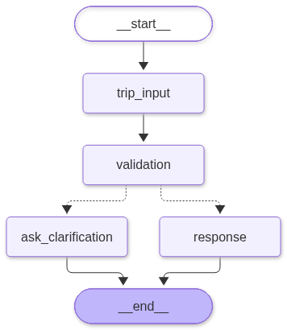
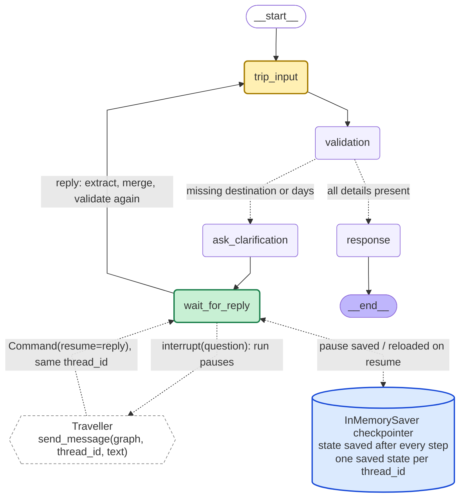
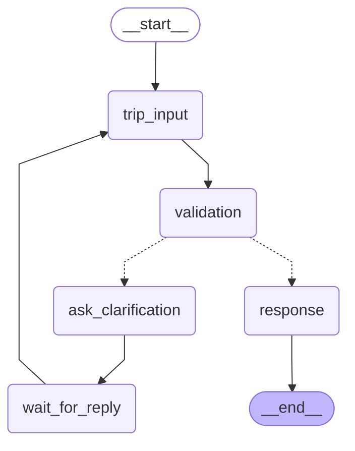

# Trip workflow graph

Generated from the compiled LangGraph in `src/ai_travel_assistant/trip_workflow.py`. Do not edit by hand; regenerate with:

```
uv run python -m ai_travel_assistant.trip_workflow --draw --png
```

This is the multi-turn graph (built with a checkpointer). Without a checkpointer, `ask_clarification` goes straight to `__end__` instead and there is no `wait_for_reply`.

| Look | Meaning |
|---|---|
| Solid arrow | Fixed edge |
| Dashed arrow from `validation` | Conditional edge, chosen by `route_after_validation` |
| Lilac node | Unchanged from the single-turn graph |
| Yellow node | Changed: `trip_input` reads each reply together with the question it answers, merges new details into the saved ones and skips blank replies |
| Green node | New: `wait_for_reply` calls `interrupt()` |
| Dashed white box | The traveller, outside the graph |
| Blue cylinder | The checkpointer (conversation memory) |

How one conversation runs:

1. `send_message` starts a run for a `thread_id`. `trip_input` extracts details and `validation` lists what is missing.
2. Missing details: `ask_clarification` writes the question, then `wait_for_reply` calls `interrupt(question)`. The run stops and the checkpointer keeps the state under that `thread_id`.
3. The traveller answers. `send_message` sees the thread is paused and sends `Command(resume=reply)` with the same `thread_id`. The state is reloaded, `wait_for_reply` re-runs and `interrupt()` returns the reply. `wait_for_reply` returns the reply together with the question it answers, saved as `clarification_context`.
4. Back to `trip_input` with the reply. The extractor receives the reply, that question and the details already known, so a short answer like `3` is read as days after *How many days...?*. New details are merged into the saved ones (a missing value never erases a saved one), the question is cleared, and the result is validated again. Steps 2-4 repeat until nothing is missing; each round uses its own latest question.
5. All details present: `response` confirms the trip and the run ends.





<details>
<summary>Raw graph, exactly as LangGraph draws it</summary>



</details>
