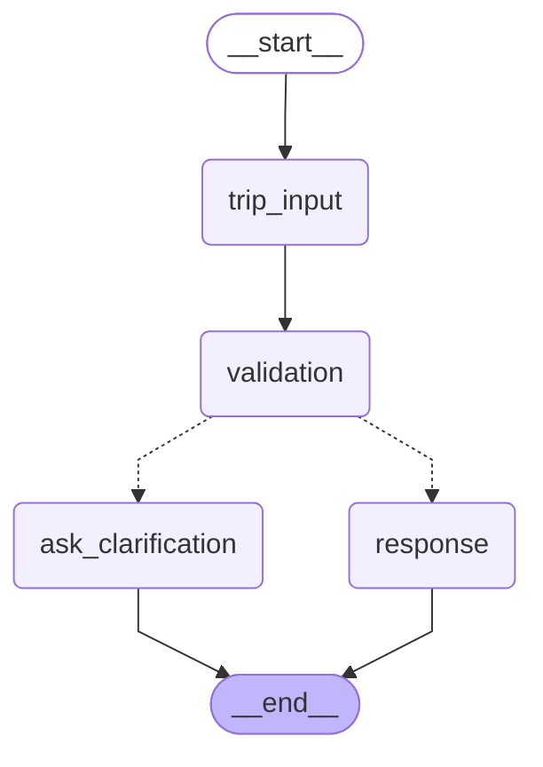

# Trip workflow graph

Generated from the compiled LangGraph in `src/ai_travel_assistant/trip_workflow.py`. Do not edit by hand; regenerate with:

```
uv run python -m ai_travel_assistant.trip_workflow --draw --png
```

Solid arrows are fixed edges. Dashed arrows are the conditional edge: `route_after_validation` picks `ask_clarification` when destination or days is missing, and `response` otherwise.



